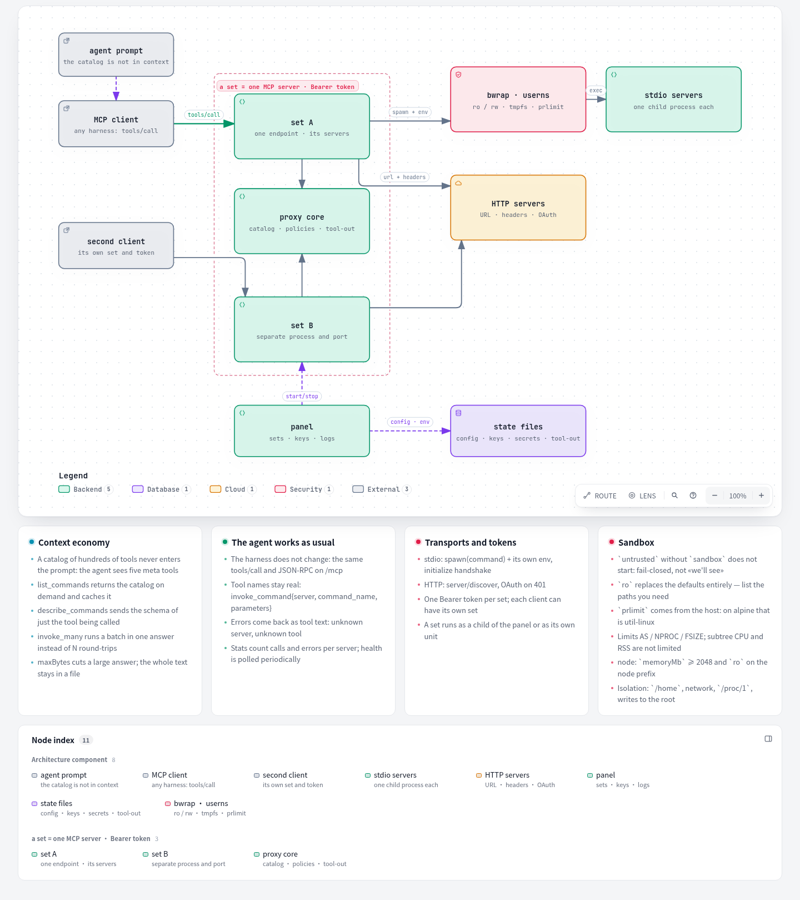
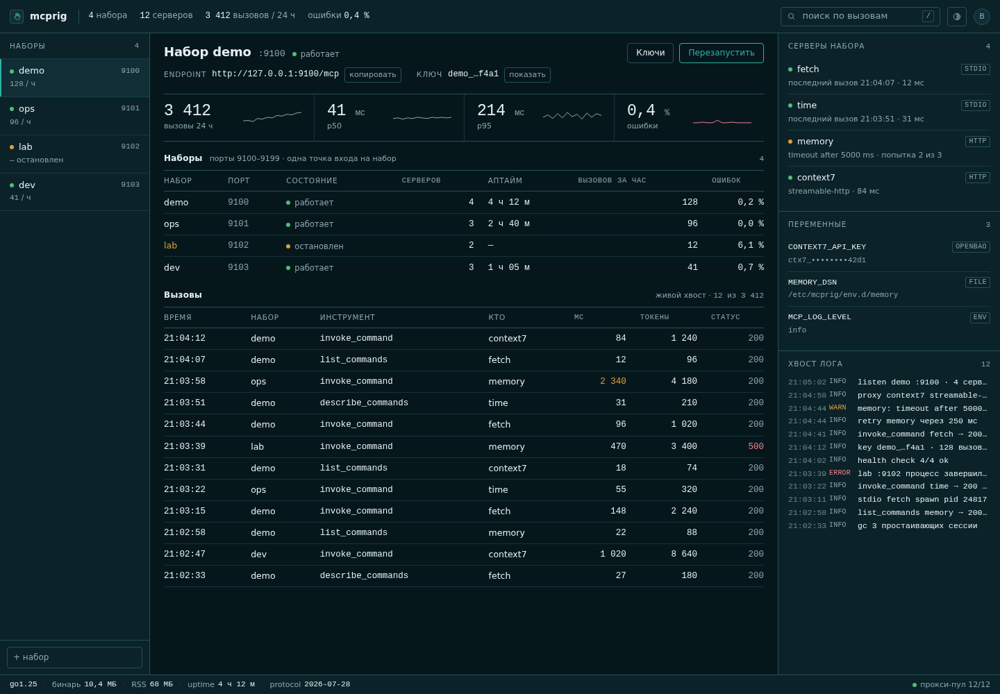

<p align="center">
  <picture>
    <source media="(prefers-color-scheme: dark)" srcset="design/mcprig/logo-hand-dark.png">
    
  </picture>
</p>

[English](README.md) · [Русский](README.ru.md)

# mcprig

One static Go binary that serves many MCP servers through one endpoint, with a
web panel.

## What it is

mcprig is three things in one binary:

- a **proxy** that exposes five meta-tools (`list_servers`, `list_commands`,
  `describe_commands`, `invoke_command`, `invoke_many`) instead of loading every
  downstream tool into the client's context;
- a **manager** that keeps the registry of servers and sets, supervises one
  process per set, and issues access keys;
- a **web panel** for the same registry and the live call tail.

A **set** is a named group of downstream servers published as one MCP endpoint.
Each set runs as its own `mcprig serve` process on its own port with its own
bearer key (or explicitly open), so a restart or a crash of one set does not
touch the others.

Release notes live in [CHANGELOG.md](CHANGELOG.md).

`servers.json` is the lazy-mcp format, read as-is: `servers[]`, both `command`
forms, `url`, `env`, `envAllow`, `headers`, `sandbox`, `transport`,
`healthMonitor`, `requestTimeout`. A server with a broken field stays in the list as unhealthy
with its error; a missing name or invalid JSON fails the load.

A `sandbox` block puts a stdio server under `bubblewrap`: read-only root,
no `/home`, no network, `prlimit` limits. `"sandbox": {}` is enough to turn it on;
a server tagged `untrusted` cannot start without it. Details and what it does not
limit — [docs/en/configuration.md](docs/en/configuration.md#sandbox).

## Architecture

[](docs/diagrams/mcprig.architecture.en.html)

The picture in full: an interactive HTML version (themes, zoom, PNG/SVG export)
is `docs/diagrams/mcprig.architecture.en.html`, and the spec it is generated
from is `docs/diagrams/mcprig.architecture.en.json`. Russian: `…ru.html` /
`…ru.json`.

## Compared to lazy-mcp

lazy-mcp is the project mcprig grew out of, and mcprig speaks its configuration.
The numbers below are measured on one host against the **same** eleven
downstream servers (search, documentation, browser and infrastructure servers;
421 tools in total), through the same five meta-tools.

| | mcprig 0.1.0 (measured) | lazy-mcp 2.10 (Docker, `node dist/cli.js`) |
| --- | --- | --- |
| proxy process RSS, warmed up, 421 tools cached | **29 MiB** | 67 MiB |
| RSS before the first call | **13 MiB** | — |
| start until the listener is up | **7–8 ms** | 95–137 ms (bare node) plus the container entrypoint |
| `tools/list`, p50 | **0.9 ms** | 3.2 ms |
| `list_commands` over all 11 servers, p50 | **5.6 ms** | 10.9 ms |
| `list_servers` (health from cache), p50 | **1.3 ms** | — |
| distribution | **one 12 MB static binary, no runtime dependencies** | 4.9 GB image with node, npm and baked MCP servers |
| crash of one set | own process, other sets keep serving | the whole proxy is one process |

Both proxies stay out of the way: a warm `list_commands` costs the proxy under
10 ms while the answer is 174 KiB of JSON, and 2 000 calls in a row leave RSS
flat (34 → 30 MiB, GC returns the rest).

Honest caveats: the eleven downstream servers dominate either footprint — a
warm set holds node/python processes worth ~1.5 GiB, of which the proxy is 29
MiB. The first `list_commands` after a start takes ~11 s if it arrives while
the set is still warming (eleven `npx`/`uvx` servers booting in the
background); once the warm-up finishes, the same call answers in 6 ms and the
first client request after it in ~27 ms. lazy-mcp pays the same cold price in
the same place. Health probes are cached for 15 s, and the tool list is cached
for the life of a session, so a downstream that changes its tools on a live
connection would look stale until it reconnects or the client sends
`{"refresh": true}`.

## Quick start

Go 1.27 is required; `GOTOOLCHAIN=auto` downloads the toolchain on the first build.

```bash
# 1. build
go build -o mcprig ./cmd/mcprig

# 2. run the panel (loopback only, no login on this local demo)
MCPRIG_AUTH=off ./mcprig panel
# from another shell:
curl -s http://127.0.0.1:9091/healthz
# {"sets":0,"status":"ok"}
```

In the panel, add a server, add a set containing it, press **Start**, then issue
a key (**Keys** → issue). The token is shown once; save it to `demo.key`
(`chmod 600`). Then print a client fragment:

```bash
# 3. connect a client
./mcprig init --client opencode --set demo \
  --remote http://127.0.0.1:9100/mcp --key-file ./demo.key
```

```json
{
  "mcp": {
    "servers": {
      "mcprig-demo": {
        "enabled": true,
        "headers": {
          "Authorization": "Bearer <token>"
        },
        "type": "remote",
        "url": "http://127.0.0.1:9100/mcp"
      }
    }
  }
}
```

`--client claude` prints `mcpServers` JSON for `claude_desktop_config.json`;
`--client codex` prints TOML for `~/.codex/config.toml`. For a stdio client
(the client spawns the binary), pass `--config <servers.json>` instead of
`--remote`. `init` writes nothing to disk.



The panel ships six colour schemes — mcprig dark (default), light, Nord,
Gruvbox, Solarized and Tokyo Night — picked in the header and remembered in
`localStorage`; the first visit follows `prefers-color-scheme`.

## CLI

| command | what it does | example |
| --- | --- | --- |
| `serve` | runs one set from `servers.json` as an HTTP MCP endpoint | `mcprig serve --config ./servers.json` |
| `stdio` | serves one set over stdin/stdout; the client owns the process | `mcprig stdio --config ./servers.json` |
| `panel` | runs the manager and the web panel | `MCPRIG_PASSWORD=... mcprig panel` |
| `init` | prints a client config fragment; writes no files | `mcprig init --client claude --set demo --remote http://127.0.0.1:9100/mcp --key-file ./demo.key` |
| `doctor` | one-pass health report: config, sets, keys, secrets, services | `mcprig doctor -json` |
| `warm` | loads a set's tool cache so the first client call is fast | `mcprig warm --set demo` |

Flags, verbatim:

| command | flags |
| --- | --- |
| `serve` | `-config` (default `os.UserConfigDir()/mcprig/servers.json`), `-addr`, `-version` |
| `stdio` | `-config` (same default) |
| `panel` | none; configured through `MCPRIG_*` environment variables |
| `init` | `-client` (default `opencode`), `-set` (default `demo`), `-remote`, `-key`, `-key-file`, `-binary` (default `mcprig`), `-config` |
| `doctor` | `-config` (same default), `-json` |
| `warm` | `-url`, `-panel`, `-set` (default `main`), `-all`, `-timeout` (default `2m`), `-token`, `-token-file`, `-config`, `-json`, `-password`, `-secret`, `-user` |

Flags accept one or two dashes (`-config` and `--config` are the same).
Exit codes: `0` for help, `2` for a command-line error, `1` for everything
else. Details and examples: [docs/en/cli.md](docs/en/cli.md).

## Configuration

`servers.json` is the same file lazy-mcp reads. A minimal set:

```json
{
  "servers": [
    {
      "name": "fs",
      "command": ["npx", "-y", "@modelcontextprotocol/server-filesystem", "/srv/docs"],
      "env": {"LOG_LEVEL": "warn"},
      "tags": ["files", "local"]
    },
    {
      "name": "serena",
      "url": "http://127.0.0.1:8899/mcp",
      "headers": {"Authorization": "Bearer ${SERENA_TOKEN}"},
      "tags": ["code"]
    },
    {
      "name": "db",
      "command": ["/usr/local/bin/db-mcp"],
      "env": {"DB_PASSWORD": "{file:/run/secrets/db_password}"},
      "enabled": false
    }
  ],
  "transport": {
    "type": "http",
    "host": "127.0.0.1",
    "port": 9100,
    "path": "/mcp",
    "authToken": "{file:/home/me/.config/mcprig/demo.token}",
    "allowedHosts": ["127.0.0.1", "localhost"]
  },
  "permissions": {
    "default": "allow",
    "rules": [
      {"server": "db", "pattern": "drop_*", "action": "deny", "message": "no destructive SQL"}
    ]
  },
  "requestTimeout": 120000
}
```

`${VAR}` is taken from the environment of the set process; `{file:/absolute}`
reads a secret file and strips one trailing newline. `serve` refuses to start
without `transport.authToken` unless `transport.allowAnonymous` is true. Full
field reference: [docs/en/configuration.md](docs/en/configuration.md).

## Meta tools

| tool | what it returns |
| --- | --- |
| `list_servers` | every server with `type`, `enabled`, `healthy`, tags; optional `filter` over name, description and tags |
| `list_commands` | commands of one server (`server`) as an array, or of several (`servers`) as an object keyed by name |
| `describe_commands` | input schemas for the named commands; unknown names land in `missing` |
| `invoke_command` | runs `command_name` on `server`; downstream inputs go inside `parameters` |
| `invoke_many` | up to 8 independent calls in one request, answered in input order; one failing call does not sink the rest |

All five are thin wrappers over the downstream MCP servers. Response forms:
[docs/en/meta-tools.md](docs/en/meta-tools.md).

## Security defaults

| area | default |
| --- | --- |
| set bearer | compared in constant time; an empty `authToken` refuses to start unless the set is explicitly open |
| panel password | plain text or `scrypt$N$r$p$salt$hash`; constant-time compare; 5 failed logins per minute per IP, at most two scrypt hashes computed at once with up to 8 waiting, and a request beyond that gets `429` |
| panel session | `mcp_session` cookie: random id signed with HMAC-SHA256, 12 h TTL, `HttpOnly`, `SameSite=Lax`, `Secure` over TLS; sessions live in memory, so a restart logs everyone out |
| CSRF | writes reject `Sec-Fetch-Site: cross-site`, require `Origin` to match `Host`, and require a JSON body |
| Host policy | empty `allowedHosts` / `MCPRIG_ALLOWED_HOSTS` means loopback only; `*` disables the check |
| tokens | the panel and API return only the 8-character prefix; the full token is shown once, when a key is issued or a set is created (`POST /api/sets` returns it in `201`) |
| tool answers | values of a server's `env`/`headers` with a secret-like name are replaced with `***` in text answers before counters and `tool-out` |
| `/stats` | on an open set, client labels become `(аноним)` and error text is dropped |
| request body | 4 MiB cap on the MCP endpoint |

## Install

Release archives are built by CI (`.github/workflows/release.yml`) for linux and
darwin on amd64 and arm64 (`mcprig_<version>_<os>_<arch>.tar.gz`, plus
`checksums.txt`) and published on GitHub releases
(<https://github.com/akrhin/mcprig/releases>). Release notes for a tag come from
`CHANGELOG.md`.

- systemd user units: `deploy/mcprig.service` (panel) and
  `deploy/mcprig-set@.service` (one set per unit).
- Docker: `slim` (binary only, HTTP downstreams) and `full` (adds node and
  python for `npx`/`uvx` stdio servers). Both are published to GitHub Container
  Registry as `ghcr.io/akrhin/mcprig:0.4.0-slim`, `:0.4.0-full`, with
  `latest`/`latest-full` following the release — no login needed.

Details: [docs/en/install.md](docs/en/install.md).

## Development

```bash
go build ./...
go vet ./...
go test ./... -race -count=1 -p 1
E2E_BASE=http://127.0.0.1:9091 ./scripts/contract-e2e.sh
bash scripts/dev-real-set.sh
```

`dev-real-set.sh` builds the binary and starts a panel plus one open set against
real serena, socraticode and xerj instances; `bash scripts/dev-real-set.sh stop`
shuts it down. More: [docs/en/development.md](docs/en/development.md).
Issues and pull requests follow [CONTRIBUTING.md](CONTRIBUTING.md).

## Status

Pre-1.0, single operator: one panel, one password, no per-user roles. Stages 0–6
are accepted (config, proxy core, OAuth, HTTP transport, manager, panel,
delivery); releases up to 0.4.0 are published. CLI help and log lines are
Russian in this build.

License: MIT, see [LICENSE](LICENSE).
