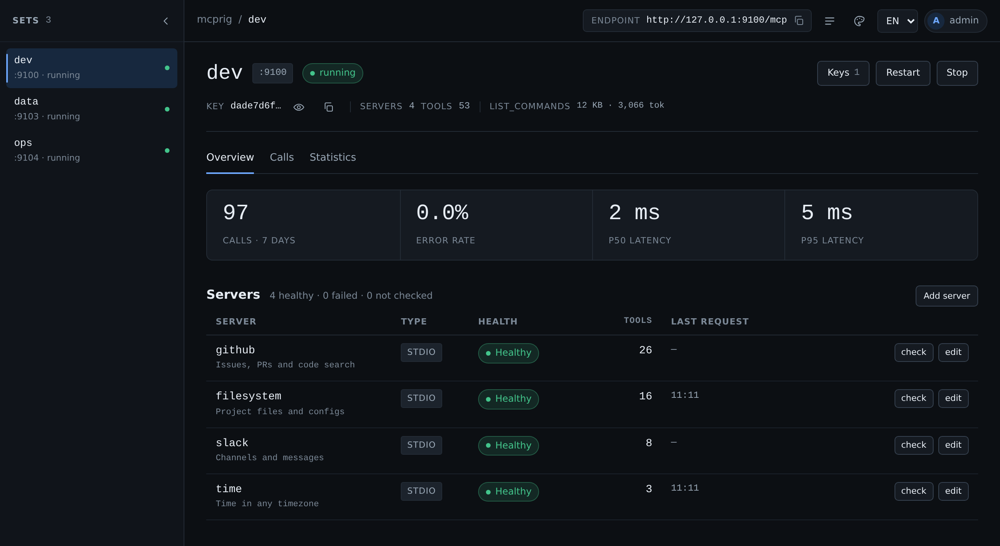
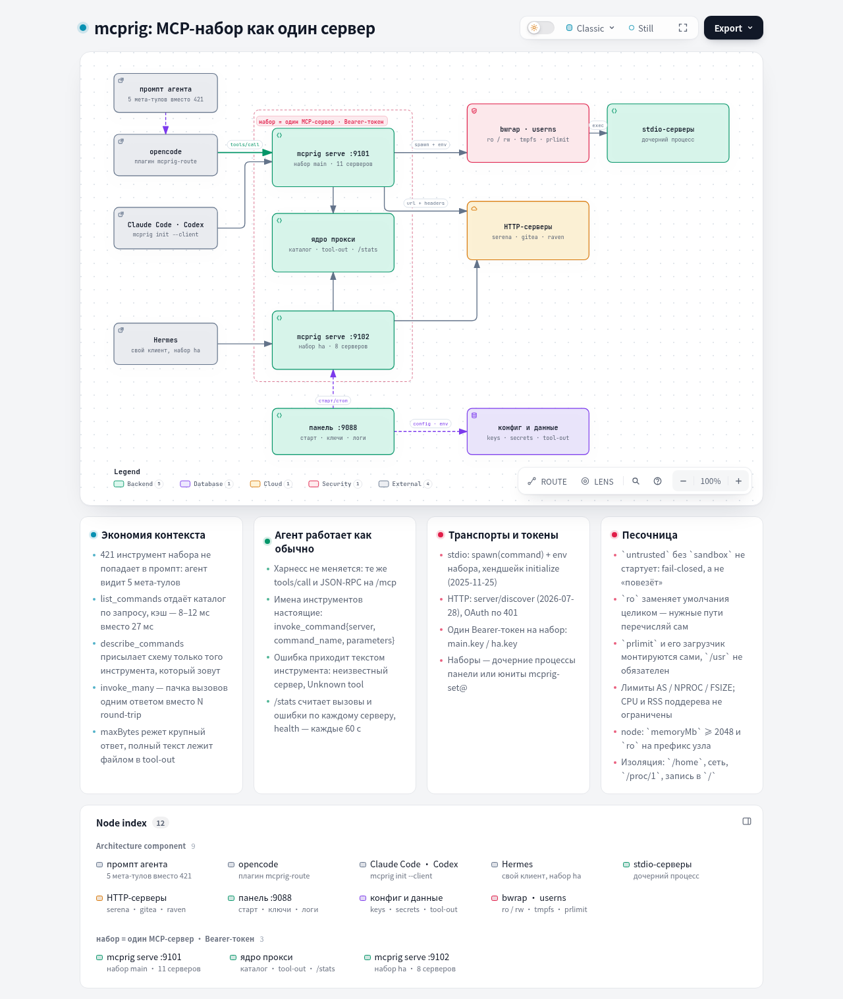

<p align="center">
  <picture>
    <source media="(prefers-color-scheme: dark)" srcset="design/mcprig/logo-hand-dark.png">
    
  </picture>
</p>

# mcprig

Один статический бинарник на Go, который отдаёт много MCP-серверов через одну MCP-точку входа, с веб-панелью.

[](https://github.com/akrhin/mcprig/releases) [](LICENSE) [](go.mod)

Клиент, который ходит в десяток MCP-серверов, платит за десяток списков
инструментов в контексте ещё до первого вопроса. mcprig убирает их за пять
мета-тулов, собирает серверы в именованные наборы, держит каждый набор отдельным
процессом со своим портом и ключом и управляет реестром из веб-панели.

- Пять мета-тулов вместо всего каталога инструментов
- Одна точка входа и один ключ на набор
- Реестр, ключи и живой поток вызовов в панели
- Песочница для stdio-серверов, OAuth для удалённых
- Один статический бинарник без зависимостей

**Документация:** [docs/ru](docs/ru/index.md) — установка, конфигурация, CLI, панель,
мета-тулы, архитектура. English: [docs/en](docs/en/index.md).

## Быстрый старт

Архивы релиза есть для linux и darwin на amd64 и arm64. Linux amd64:

```bash
curl -LO https://github.com/akrhin/mcprig/releases/download/v0.4.0/mcprig_0.4.0_linux_amd64.tar.gz
tar -xzf mcprig_0.4.0_linux_amd64.tar.gz
MCPRIG_PASSWORD=change-me ./mcprig panel
```

Откройте <http://localhost:9091>, войдите как `admin`, добавьте сервер, добавьте
набор с этим сервером, нажмите **Start**, затем выпустите ключ набора. Панель
показывает токен один раз: сохраните его в `demo.key` и выставьте `chmod 600`.



*Панель: наборы со своими портами и эндпоинтами и серверы одного набора — транспорт и число инструментов.*

Docker работает так же и не требует Go: `docker pull ghcr.io/akrhin/mcprig:latest`
(`latest-full` добавляет node и python для `npx`/`uvx`-серверов). Юниты systemd,
состав архива и каталог состояния: [docs/ru/install.md](docs/ru/install.md).

## Подключение клиента

`init` печатает фрагмент для конфигурации самого клиента и никогда её не правит:

```bash
./mcprig init --client claude --set demo \
  --remote http://127.0.0.1:9100/mcp --key-file ./demo.key
```

```json
{
  "mcpServers": {
    "mcprig-demo": {
      "type": "http",
      "url": "http://127.0.0.1:9100/mcp",
      "headers": {
        "Authorization": "Bearer <token>"
      }
    }
  }
}
```

`--client opencode` печатает JSON с корнем `mcp`, `--client codex` — таблицу TOML.
Если клиент сам запускает бинарник, вместо `--remote` передайте
`--config ~/.config/mcprig/sets/demo/servers.json`: фрагмент будет запускать
`mcprig stdio` без порта и без ключа. Обе формы с реальным выводом:
[docs/ru/cli.md](docs/ru/cli.md#init).

## Архитектура

[](docs/diagrams/mcprig.architecture.ru.html)

Клиент → одна точка входа набора → пять мета-тулов → нижестоящие серверы этого
набора. Панель держит по одному процессу `mcprig serve` на набор, поэтому
перезапуск или падение одного набора не задевает остальные. Интерактивная версия
схемы (темы, зум, экспорт PNG/SVG) —
[docs/diagrams/mcprig.architecture.ru.html](docs/diagrams/mcprig.architecture.ru.html);
спецификация, из которой она генерируется, лежит рядом как `.json`.

## Конфигурация

Набор — это один `servers.json` в формате lazy-mcp, читаемый как есть: `servers[]`
с `command` или `url`, плюс `env`, `headers`, `sandbox`, `transport`,
`permissions`. Панель пишет тот же файл для наборов, которыми управляет, так что
конфигурация ручная и конфигурация из браузера — не два разных формата.

`"sandbox": {}` ставит stdio-сервер под `bubblewrap`: корень только на чтение, без
`/home`, без сети, лимиты через `prlimit`. Сервер с тегом `untrusted` без неё не
запустится. Справочник полей и чего песочница не ограничивает:
[docs/ru/configuration.md](docs/ru/configuration.md).

## Безопасность по умолчанию

Набор без `authToken` отказывается стартовать, если не открыт явно; пароль панели
сравнивается за постоянное время с ограничением попыток по IP; токен один раз
отдаётся целиком, дальше — префиксом. Режимы авторизации, политика `Host`,
правила `permissions`, лимиты и потолок тела 4 МиБ:
[docs/ru/configuration.md](docs/ru/configuration.md) и
[docs/ru/panel.md](docs/ru/panel.md).

## Состояние

До 1.0, один оператор: одна панель, один пароль, без ролей пользователей. Справка
CLI и строки логов — на русском.

Issues и pull requests — по [CONTRIBUTING.ru.md](CONTRIBUTING.ru.md). Об
уязвимостях: [SECURITY.md](SECURITY.md).

## Лицензия

MIT, см. [LICENSE](LICENSE).

---

[English](README.md) · [Русский](README.ru.md)
