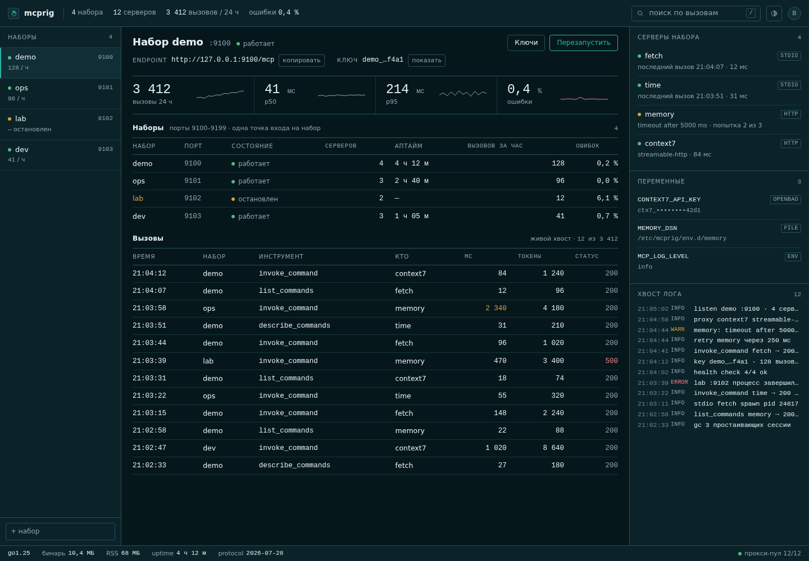

This file describes what the panel shows, the API behind it, and how access to
both is checked.

# Panel

`mcprig panel` serves the registry and a single-page dashboard from the same
binary. The UI is embedded (`web/`), has no build step, and runs with a strict
CSP: no inline scripts or styles.



## What it shows

| area | contents |
| --- | --- |
| header | counters: sets, servers, calls in the tail, errors |
| left rail | all sets, their state and port; **+ set** |
| set card | name, port, state, endpoint, active key prefix, **Start/Stop**, **Keys** |
| KPIs | calls in the tail, p50, p95, errors for the selected set |
| sets table | name, port, state, server count, uptime, calls, errors |
| calls table | time, server, tool, client, milliseconds, status; search box |
| right column | servers of the set with health, variables, log tail |
| footer | totals and last refresh time |

Everything on the page comes from the panel API below plus `GET /stats` of the
running sets. Nothing is stored in the browser.

The **Keys** dialog lists key ids, creation and revocation dates and notes. It
shows only the 8-character prefix; a newly issued token is displayed once.
Creating a closed set generates its first key but does not reveal the token:
issue a key to get one. Issuing a key revokes the previous active key and
restarts the set if it is running; revoking the active key stops the set.

## Routes

Static panel files are served for `GET`/`HEAD` after authentication. The API:

| method and path | purpose |
| --- | --- |
| `GET /healthz` | public liveness probe |
| `GET /` | panel (redirects to `/login` when auth is on and there is no session) |
| `GET /login`, `POST /api/login`, `POST /api/logout` | session login |
| `GET /api/state` | servers, sets, `firstPort` — the first paint |
| `GET /api/sets`, `POST /api/sets` | list and create sets |
| `PUT /api/sets/<id>`, `DELETE /api/sets/<id>` | update (restarts a running set) and delete (stops it) |
| `POST /api/sets/<id>/start`, `/stop`, `/restart` | lifecycle |
| `GET /api/sets/<id>/servers` | per-server health for one set |
| `GET /api/sets/<id>/logs?lines=N` | log tail (default 200 lines) |
| `GET /api/sets/<id>/servers/<name>/logs` | one downstream's log lines |
| `POST /api/sets/<id>/servers/<name>/restart` | restart the set containing that server (response says `scope: "set"`) |
| `POST /api/sets/<id>/keys` | issue a key; the response contains the only copy of the token |
| `DELETE /api/sets/<id>/keys/<keyID>` | revoke a key |
| `GET /api/servers`, `POST /api/servers` | list and add downstream servers |
| `PUT /api/servers/<name>`, `DELETE /api/servers/<name>` | update and delete; running sets are restarted |
| `POST /api/servers/<name>/probe` | `initialize` + `tools/list`, 60 s budget, error text in the body |
| `GET /api/calls?set=<id>&limit=<N>` | merged call tail of running sets; default 50, max 500 |
| `GET /api/env`, `PUT /api/env/<NAME>`, `DELETE /api/env/<NAME>` | variables: names, set flag and source only — never values |
| `POST /api/import` | import an `mcpServers` object; returns `added` and `skipped` |
| `GET /api/export/registry`, `GET /api/export?set=<id>` | export the registry or one set |
| `POST /api/browse` | open a live session to a server for tool inspection |
| `GET /api/browse/<id>`, `DELETE /api/browse/<id>` | read or close that session |
| `POST /api/browse/<id>/{tool,resource,prompt}` | call something in the browse session |

Set and server names must match `^[a-z0-9][a-z0-9_-]{0,63}$`. A set needs at
least one existing server; its `port`, when given, must be 9100–9199, otherwise
the manager allocates one. `id` and `token` in a create body are ignored.

`/api/calls` polls each running set's `/stats` with a 2 s timeout and its
registry key. A set that does not answer is listed in `unreachable` by id; its
error text is not forwarded.

## Health

| endpoint | response |
| --- | --- |
| `GET /healthz` (panel) | `{"status":"ok","sets":N}`, or `503` with `status: "degraded"` when an `autostart` set is not running |
| `GET /healthz` (set) | plain `ok` |
| `GET /stats` (set) | JSON snapshot for the panel; `Authorization` required unless the set is open |

Both panel health endpoints are public so a container or systemd check can use
them without credentials. The panel's `/healthz` contains no set names.

## Access

Modes come from `MCPRIG_PASSWORD`, `MCPRIG_PROXY_SECRET` and `MCPRIG_AUTH=off`;
see [cli.md](cli.md#panel). There is no built-in TLS: put the panel behind a
reverse proxy, or keep it on loopback.

```text
none      MCPRIG_AUTH=off
password  MCPRIG_PASSWORD or MCPRIG_PASSWORD_HASH
proxy     MCPRIG_PROXY_SECRET + MCPRIG_USER_HEADER
both      password and proxy secret
```

With password auth the panel sets `mcp_session` (HMAC-SHA256, 12 h, `HttpOnly`,
`SameSite=Lax`, `Secure` over TLS) and keeps sessions in memory. Login is
limited to 5 failures per minute per IP and runs at most one scrypt at a time.
An unauthenticated `GET /` redirects to `/login`; API calls get
`401 {"error":"нужна авторизация","login":true}`.

Proxy auth accepts a request when the user header (`Remote-User` by default)
is non-empty and `x-mcp-proxy-secret` matches `MCPRIG_PROXY_SECRET` in constant
time. Both modes can be combined; either one is enough to pass.

Writes (`POST`/`PUT`/`DELETE`) are rejected when `Sec-Fetch-Site` is
`cross-site`, when `Origin` does not match `Host`, or when the body is not
JSON. `Host` must be in `MCPRIG_ALLOWED_HOSTS`; an empty list means loopback
only.
