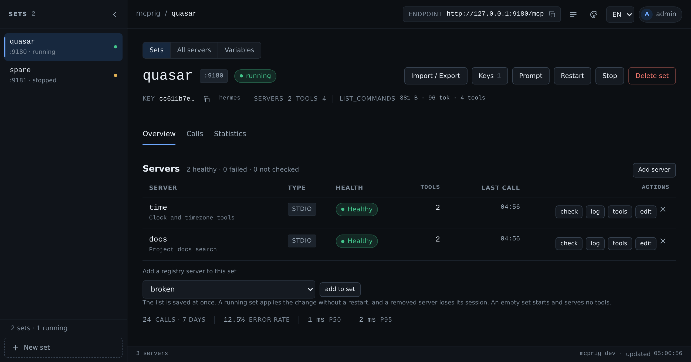

[← Docs index](index.md)
EN · [RU](../ru/panel.md)

This file describes what the panel shows, the API behind it, and how access to
both is checked.

# Panel

`mcprig panel` serves the registry and a single-page dashboard from the same
binary. The UI is embedded (`web/`), has no build step, and runs with a strict
CSP: no inline scripts or styles.



## What it shows

| area | contents |
| --- | --- |
| top bar | breadcrumbs `mcprig / <page or set>`, the MCP endpoint of the open set with a copy button, the appearance menu — **theme** (Default or Windows 98) and the colour scheme of that theme — the interface language, and a static `admin` chip that is hidden on narrow screens |
| left rail | all sets as name plus `:port · state` and a state dot; **+ New set** |
| pages | **Overview** at `#/`, **Sets** at `#/sets`, **Statistics** at `#/stats/<period>`, **All servers** at `#/servers` and **Variables** at `#/vars`, as pills at the top of the content; a set keeps `#/set/<id>` and each of its tabs has its own address, so a reload, a back button and a shared link all land where they should |
| sets page | the list of sets at `#/sets`: name with `:port`, state, the number of servers and of keys; a row opens the set. An address that names no set — the bare `#/sets` or a route the panel does not know — lands here, not on the set that was open last; deleting the open set lands here too, not on a neighbour |
| host overview | what the daemon is serving right now: sets running and sets stopped, servers ok, not checked and failing, tools waiting for approval, calls and error rate over the last 7 days, and the size and retention of `/tool-out` as a dash — the API has no field for it, so the panel says so instead of guessing. Under the tiles: every set by last call with its state and the daemon's reason, and the latest calls of all sets; a row opens that set. On a phone each call reads as a card — time and status, set and server, tool and duration — while the sets list keeps its columns |
| set head | name, port chip, state badge, **Import / Export**, **Prompt**, **Restart**, **Start/Stop**, and the red **Delete set** that removes the set and its directory; under them the key prefix with its `key:<mark>` label, the number of servers and tools plus the `list_commands` weight (bytes, tokens) |
| tabs | **Overview**, **Servers**, **Keys**, **Tools**, **Calls** and **Logs** of the open set, at `#/set/<id>`, `#/set/<id>/servers`, `…/keys`, `…/tools`, `…/calls` and `…/logs`; an unknown tab opens **Overview**, a tab click adds a history entry, and the back and forward buttons walk through the tabs |
| KPIs | calls, error rate, p50 and p95 of the selected set over the last 7 days, under the tiles of the set **Overview** |
| servers of the set, on the **Servers** tab | name with a second line (daemon error, isolation, description), type, health, tool count, last request, **Check**, **Log**, **Tools**, **Edit** and the **×** that detaches the server from the set; under the table sit the registry picker and **add to set** |
| all servers page | the whole registry of the host: name with the daemon's reason on the second line, type, health, tool count from the last **Check**, the sets the server belongs to, and **Check**, **Authorize**, **Log**, **Edit** and the **×** that deletes it from the registry; **Add server** sits in the head |
| import and export | the **Import / Export** dialog: the whole registry or one set as JSON, with **Download JSON** and **Copy**; import from a JSON file or a pasted `mcpServers` object — the preview names the servers that will be added, sets found in the file are skipped with a note (sets are made in the panel), and `env` and `headers` go out and come in as written |
| calls table | time, server, tool, client, milliseconds, status; search box and **errors only**. Meta-tools (`list_servers`, `list_commands`, `describe_commands`) appear here too, as server `mcprig`; a failure shows its reason next to the status, the full text in a tooltip |
| statistics page | the period (today, 7 days, 30 days, archive), the server, tool and client filters and **reset**, totals and the series. The first answer arrives as soon as the sets are known, so a direct `#/stats/<period>` link is filled at once instead of waiting for the 15 s tick. The three filters are kept in the browser (`localStorage`, `mcprig.stats.*`) and survive a reload; the set of the view still follows the rail |
| variables page | every `${NAME}` your servers reference with whether a value is set and where it comes from, a form that writes a value, and the **×** that forgets it |
| logs tab | the log tail of the set with **refresh**; it is a tab, not a drawer, so the log keeps its place in the address `#/set/<id>/logs` |
| footer | the status bar: `M servers` of the registry, `mcprig <version>` and the time it was updated. The sets and how many are running are the line at the bottom of the left rail — `N sets · M running` |

Health is shown as it is: `Healthy`, `Failed` with the daemon's reason on the
second line, and `Not checked` for a server nothing has probed yet. While a
health answer is on its way the cell keeps a skeleton bar instead of guessing.
The badge of the all-servers page uses the same component and the same three
states; a server outside the open set stays **Not checked** until **Check**
probes it there, and a server of a stopped set says that the set is off.
The tool count of one server is not part of the health answer, so the **Tools**
column shows `—` until **Check** probes that server; the head of the set shows
the total for the whole set.

The browser title names what is open: `mcprig — Overview`, `mcprig — Sets` and
the like for other pages, `mcprig — set <name>` on a set, and with ` · <tab>`
when a tab other than **Overview** is open.

Everything on the page comes from the panel API below plus `GET /stats` of the
running sets. Nothing else is stored in the browser but the chosen theme, its
colour scheme and the interface language.

## Demo mode

`?mock=1` on the panel URL runs the UI against `web/mock/*.json`: the same API
URLs the page asks for are answered from those files instead of `/api/…`
(`mockName` in `web/app.js`), so no registry, set or stats need to exist. The
files are embedded in the binary (`web/embed.go`) and served only under `mock/`
(`internal/manager/panel.go:36`), behind the same session check as the rest of
the panel.

It shows five sets — `main`, `demo`, `ops`, `dev` and `lab` — with servers,
health, calls, quarantine rows, logs and all four statistics periods. Everything
in them is fictional: names, ports, clients and numbers are made up, so a
screenshot or a walkthrough exposes nothing real. Writes — editing a server,
approving a descriptor, adding or forgetting a variable — are applied in memory
and vanish on reload; nothing reaches the registry. Statistics are computed in
the browser from the generated rows, so filters and periods behave like the
live ones.

## Server editor

The **Edit** button of a row on the **All servers** page and the **Add server**
button of that page open a
form over the panel: name, description, transport, command (one argument per line) or
`url` and headers, working directory, `env`, `envAllow`, tags, the `enabled`
switch, two **expose** checkboxes (`resources`, `prompts`) and a **sandbox**
fieldset — `mode`, `onUnavailable`, `network`, `ro` and
`rw` (one path per line), `memoryMb`, `pids`, `tmpMb`, `timeoutSec`. It writes
through `POST /api/servers` and `PUT /api/servers/<name>`; a backend refusal is
shown in the form as its own text and the stored record stays untouched.

With both **expose** boxes unchecked the record carries no `expose` at all: the
MCP client sees that server's tools only. Checking them is the only way to give
the client its resources or prompts ([meta-tools.md](meta-tools.md#resources-and-prompts));
an unknown value never comes from the form, but a hand-edited `registry.json`
typo is refused by the backend with `expose: неизвестный вид …`.

The same form is the only way to edit a `sandbox` block from the UI. Fields and
their meaning are in [configuration.md](configuration.md#sandbox); the panel
does not validate them itself — it shows what the backend answers, including
`sandbox: неизвестные поля: …`, `sandbox допустим только для stdio` and
`тег untrusted требует sandbox: сервер без изоляции не стартует`.

Each server row has a **Log** button: it opens a drawer with the set's log
filtered by that server's name plus the tail of the server process's own stderr
(`sets/<id>/serverlogs/<name>.log`). The tail survives a stop so the trace of a
crash stays readable, and it is cleared on the next start of the set; an automatic
restart after a crash appends to the same file under a new marker instead, so the
reason the server died is not wiped a second after it died. The drawer
reads `GET /api/sets/<id>/servers/<name>/logs?lines=200` and prints the lines as
text; a server that has neither shows `log is empty`, and a failed request keeps
the lines already shown and reports the reason above them. Every start writes a
`— запуск <date time> —` marker first, so a restart after a crash is told apart from
the first start; when the tail exists but cannot be read, the answer carries `error`
and the drawer prints it instead of pretending the server was silent. The set
lines come first and the process tail after them, so the two are not one merged
timeline; a line that names both the server and the access log appears twice.

The **Tools** button of a row switches to the **Tools** tab with that server
picked in its **Server** filter
([meta-tools.md](meta-tools.md#descriptor-quarantine)): one line per tool with
its state — `approved`, or `changed` in warning colour with an **approve**
button. It reads `GET /api/sets/<id>/tools` and keeps the server's entries;
**approve** sends `POST /api/sets/<id>/tools/approve` and the list is read
again, so the row turns `approved` on the spot. Until then the proxy refuses
that tool's calls. The tab shows what the set process wrote, so without a set
data directory (`MCPRIG_DATA_DIR`) every tool reads `approved`; entries of a
server removed from the set are pruned when the set config is rebuilt.

The **All servers** page shows isolation on the second line of a row: `bwrap`
when the sandbox is applied, `no isolation` in warning colour when
the block was requested but bubblewrap did not start (the daemon's full reason
is in the tooltip), and `config rejected` in error colour for a record with
`_configError`. A valid server without a `sandbox` block carries no marker. The
value comes from the same `isolation` field MCP clients see in `list_servers`.

The **Keys** tab lists key ids, creation and revocation dates and notes. It
shows only the 8-character prefix. When the set has a `profiles` block, the
issue form carries a **Profile** select (empty means no profile); one
`POST /api/sets/<id>/keys` carries both the label and the chosen profile as
`{"label":…,"profile":…}`, a `400` from the daemon (an unknown profile) is shown
in the tab itself and the form stays as it is, and every key row shows its
profile as a badge. A set without profiles keeps the form as it was. The label of
an existing key is edited in place: the row has a label field and a **Save**
button that appears once the value differs from the stored one; the panel sends
`PATCH /api/sets/<id>/keys/<key>` with `{"label":…}`, redraws the list and shows
a failed restart as its own warning rather than swallowing it. The daemon still
accepts `note` as the old name of `label`, for clients written before the rename;
the panel never sends it. A newly issued token is displayed once, and
so is the token of a newly created closed set: `POST /api/sets` returns it in
the `201` body, while `GET /api/sets` never repeats it. Issuing a key neither
revokes the previous active key nor restarts the set: the new token reaches a
running set by reload, and the old one keeps working. Revoking the last active
key stops the set; revoking one of several leaves it running.

## All servers and variables

The **All servers** page lists the whole registry of the host, not the
composition of one set. A row carries the name with the daemon's reason of a
failure below it, the transport, the health badge, the tool count the last
**Check** found, the sets the server belongs to and the actions: **Check**
(`POST /api/servers/<name>/probe`), **Authorize** for a remote server that
answered `401`, **Log** of the open set, **Edit** and the **×** that deletes the
server from the registry — the dialog names the sets it leaves first. Deleting
from the registry is not the same as detaching from a set: the set composition
lives on the **Overview** tab.

The **Variables** page is where `${NAME}` gets its value. The list shows every
name your servers reference with `set` or `unset` and the source — `openbao`,
`file` or `env` — because the panel reads `GET /api/env`, which carries names,
the flag and the source and never a value. The form writes one with
`PUT /api/env/<NAME>`: name, value and store (`automatic` — OpenBao when it is
configured, the file otherwise — `OpenBao` or the file), and the **×** forgets
one everywhere with `DELETE /api/env/<NAME>` and no `store` parameter. Both
answers come back at once, and sets that use the variable restart in the
background; the page says which ones and adds a note when no server references
the name yet. A set that did not come back is named under the form as well: both
answers carry `reloadErrors`, one `set: reason` per set that failed, and the page
prints that line next to the restarted ones — a value that is stored but not
applied must not read as success. A written value is never read back: the panel
cannot show it, and the page says so under the list.

## Set composition

The servers table of the **Overview** tab is also the place where the set is
composed. **add to set** under the table offers the registry servers that are
not in the set yet, and the **×** at the end of a row detaches that server. Both
send `PUT /api/sets/<id>` with the whole `servers` list — never a diff — so one
request carries one intent; the panel then reads `GET /api/state` again and
redraws the head, the table and the picker. The request is quiet: a refusal
appears as text right under the block, not as a toast — and so does a save that
was written but not applied: an answer carrying `failed` (one entry: the set and
the reason) or `reloadError` puts that reason in the same line, because the edit
is in the registry and the running set does not have it.

A running set takes the change by reload ([reload](#reload-without-a-restart)): a
new server joins lazily and its tools appear after the first `list_commands` or
**Check** probe, a removed one loses its session and cache. The process is not
restarted — the hint under the picker says so, because a restart would drop the
connections of every other server in the set. The one exception is a server that
brings a `${VAR}` the set did not use before: the process environment is fixed at
start, so such an addition restarts the set (the panel names the variables in its
hint instead of promising a reload). An empty list is legal: the set
saves, starts and serves no tools; the panel says that in the same place instead
of blocking the save.

## Prompt for an agent

`POST /api/sets/<id>/prompt` builds one text out of three parts: an
introduction, the set's tools and the task. The body is
`{"task":"…","intro":"…","servers":["…"]}`; `intro` and `servers` are
optional. An empty `intro` becomes a short default paragraph, an empty `task`
is `400` with `задача не задана`, and `servers` narrows the list — a name that
is not in the set is `400` as well. The answer is `{"prompt":"…","notes":["…"]}`.

The tool list comes from the live catalog of a running set: names and
descriptions from `list_commands`, input schemas from `describe_commands`,
compacted to one-line JSON. A stopped set, or one that did not answer, falls
back to the names `GET /api/sets/<id>/tools` reads from `tools.lock.json` and
says so in `notes`: `набор не запущен, схемы недоступны`. One schema is capped
at 4000 characters, the whole prompt at 64 KiB; both cuts are reported in
`notes`. The introduction and the task always stay whole; blocks of the tool
list are what gets dropped. Error text is scrubbed the same way `list_servers`
scrubs it: neither the set token nor a variable value reaches the prompt.

**Prompt** in the head of the set opens the dialog: the task is required and
the button does nothing until it is filled, the introduction is optional (empty
means the default paragraph), and the servers of the set are listed as
checkboxes — none checked means the whole set. **Build** posts to the endpoint
above; the text comes back into a monospaced block with **copy** and
**download .md**, and every `note` is shown above it, prefixed with `notes:`. A
stopped set opens the same dialog and warns before the request that the text
will carry tool names without schemas, so the missing schemas are not a
surprise after **Build**.

## OAuth

A remote server that answers `401` shows **authorize** in its row on the **All
servers** page, as long as the server belongs to the open set. The button starts
the authorization-code flow inside the daemon
and draws a dialog with the link; the browser is the user's, so the panel never
waits for it in a request — the flow is started with
`POST /api/sets/<set>/servers/<name>/authorize` and its state is polled with
`GET /api/sets/<set>/servers/<name>/authorize/status`. A `GET` on the starting
route answers `405`: only the POST changes anything. Both routes check that the
server belongs to the set and has a `url`: a server that is not in it answers
`400` with `сервер X не входит в набор Y`, so the dialog shows why instead of
polling forever, and a wrong set or server name is `404`.

| item | value |
| --- | --- |
| redirect URI | `http://<panel host>:<panel port>/oauth/callback` |
| callback route | public: the browser carries no panel session, `state` is the key |
| token file | `<data dir>/sets/<set>/oauth.json` |
| after success | the set restarts itself, so the token is picked up |
| give up after | 10 minutes |

The redirect address is the one the panel is opened at, so it must be reachable
from the browser. An authorization server that refuses plain `http` for an
address that is not loopback (dynamic registration answers `invalid_redirect_uri`)
needs TLS in front of the panel; the flow itself is the same. `mcprig auth
--set <set> <server>` does the same thing from a terminal with a loopback
listener — see [cli.md](cli.md#auth).

## Themes

Appearance has two independent axes, both switched from the one menu in the
header, without a reload: the **theme** is the look, the **colour scheme** is
what that look is painted in. `<html>` carries both — `data-theme` (`default` or
`win98`) and `data-palette`.

- `default` is the modern look with four schemes: dark (its default), light,
  Nord and Gruvbox, all on one set of CSS variables — colours, radii, the 4 px
  spacing step and the type scale.
- `win98` is the look of Windows 98: a navy title bar with the pixel logo and the
  three window buttons (decoration only — every action stays in the toolbar),
  square corners, two-tone bevels, MS Sans Serif at 11 px, a dotted focus
  rectangle inset 3 px, dark-blue selection, sunken white fields, folder tabs, a
  status bar of segments and grey scrollbars. Its rules live in `win98.css`,
  every selector under `html[data-theme="win98"]`. Four schemes share that
  geometry and change shades only (or, for High Contrast, lose them): Classic
  (`#c0c0c0` face, navy title bar), Slate (cool grey), Wheat (warm beige) and
  High Contrast (`#000` body and fields, `#fff` text and outlines, `#ffff00`
  accent and title bar text). Under `prefers-contrast: more` the bevels grow to
  3 px and the focus rectangle to 2 px in every scheme.

`theme.js` runs before first paint and sets both attributes; `themes.css` holds
the schemes — dark on `:root`, the rest under `html[data-palette="…"]`, and the
Win98 ones add the bevel tokens (`--w98-face`, `--w98-hi`, `--w98-lo`, …).
Choices are stored in `localStorage['mcprig.theme']` and `['mcprig.palette']`,
the scheme of the Win98 theme in `['mcprig.palette.win98']`, so each theme comes
back with the scheme it was left in. Names stored by earlier versions (`dark`,
`light`, `nord`, `gruvbox`, `mcprig`, `tokyo`, `solarized`) open as the `default`
theme with the same colours and no reload; an unknown value falls back to dark,
which lives on `:root`. The CSP is unchanged (no inline styles).

## Language

The interface speaks English and Russian. English is the default: the `EN`/`RU`
switch sits in the header next to the colour scheme, the choice is stored in
`localStorage['mcprig.lang']`, `<html lang>` follows it, and numbers and dates
are drawn by `Intl` in the current locale (`en-US`/`ru-RU`). Every panel string
lives in one `DICT` in `web/app.js`; `index.html` carries only the English values
and `data-i18n` keys. Strings that come from the daemon — a server error reason,
the `isolation` field, refusals shown in the form — are displayed as they are.

## Routes

Static panel files are served for `GET`/`HEAD` after authentication. The API
answers every refusal as JSON with `error`. `400` is a request that cannot be
used as sent — a broken body, a missing field, an unknown name. `409` is the
state saying no to a valid request: the port is taken by another process or
another set, the set did not come up, the set has no active key, or a `${VAR}` of
the set has no source ([secrets](configuration.md#secrets)). `500` is an
unclassified failure: the body carries a generic line, never the cause, and the
cause goes to the panel log — `journalctl --user -u mcprig.service` under the
shipped unit, the panel's stdout in a foreground run.

| method and path | purpose |
| --- | --- |
| `GET /healthz` | public liveness probe |
| `GET /` | panel (redirects to `/login` when auth is on and there is no session) |
| `GET /login`, `POST /api/login`, `POST /api/logout` | session login |
| `GET /api/state` | servers, sets, `firstPort` and `version` of the running binary (the footer prints it) — the first paint. A set's `keyMark` is the label its primary key carries in the statistics: the key's label when it has one, otherwise `key:<mark>`; empty for an open set |
| `GET /api/sets`, `POST /api/sets` | list and create sets; a new closed set returns its token once in the `201` body. A set id is lowercase latin letters, digits, hyphen and underscore (`my-lab`); a name outside the pattern is `400` with that rule in the message — the backend no longer renames it silently |
| `PUT /api/sets/<id>`, `DELETE /api/sets/<id>` | update and delete (stops it). The edit is written before it is applied, so a failed apply is never a 500: a restart that did not come back is `failed` (`{"<id>":"<cause>"}`) next to the set view, and a process that refused a reload reports it in the view's `reloadError`, so the panel does not show a saved edit as lost. A change of `port`, or a new `${VAR}` brought by a new server, restarts the set; `open` reaches the live listener by reload. A `token` in the body replaces the primary key and creates one when the set has no active key |
| `POST /api/sets/<id>/start`, `/stop`, `/restart` | lifecycle |
| `POST /api/sets/<id>/reload` | apply `servers.json` without a restart: `{"reloaded":true,"generation":N,"applied":[…],"restartNeeded":[…],"error":"…"}`. A stopped set answers `{"reloaded":false,"reason":"набор не запущен"}` and the file is written anyway. A non-empty `restartNeeded` or a set `error` gives `reloaded:false` with the cause in `reason`; a write failure is `500` |
| `GET /api/sets/<id>/servers` | per-server health for one set |
| `GET /api/sets/<id>/logs?lines=N` | log tail (default 200 lines) |
| `GET /api/sets/<id>/servers/<name>/logs` | one downstream's log lines, oldest first: a `— запуск <date time> —` marker opens each run of the process, and an unreadable tail adds `error` (absent means the server simply wrote nothing) |
| `GET /api/sets/<id>/tools` | `{"tools":[…]}` — the set's descriptor records: `server`, `tool`, `hash` (as the catalog serves it now), `approvedHash` and `state` (`ok`, `changed`) |
| `POST /api/sets/<id>/tools/approve` | approve the current descriptor: `{"server":"serena","tool":"find_symbol"}`, or `{"all":true}` for everything currently changed; answers `{"approved":["serena/find_symbol"]}`, empty when nothing needed it. The record is written with `approvedBy: "panel"` |
| `POST /api/sets/<id>/prompt` | one text for an agent out of three parts: `{"task":"…","intro":"…","servers":["…"]}` → `{"prompt":"…","notes":["…"]}`. `intro` and `servers` are optional, an empty `task` is `400`; tools come from the live catalog with their input schemas, a stopped set falls back to the `tools.lock.json` names and says so in `notes` |
| `POST /api/sets/<id>/keys` | issue a key; the response contains the only copy of the token. Earlier keys stay active, so issuing does not revoke the old one; the set serves up to 8 active keys, the ninth answers `409`. An optional `{"label":"hermes","profile":"reader"}` names and narrows the key to that profile of the set — an unknown name is `400` listing the profiles, a set without `profiles` is `400` with a hint to add the block. A running set gets the new key by reloading, not restarting; when the process did not apply it, the answer carries `reloadError` (and `restartError`, its older name) |
| `GET /api/sets/<id>/keys` | `{"keys":[…]}` — `id`, `label`, `profile`, `createdAt`, `revokedAt` of every key, revoked ones included; never a token or a hash |
| `DELETE /api/sets/<id>/keys/<keyID>` | revoke one key; the rest keep working. Revoking the last active key stops the set and the answer carries `stopped: true` and `activeKeys: 0` |
| `PATCH /api/sets/<id>/keys/<keyID>` | sign a key: `{"label":"hermes"}` (`{"note":…}` still accepted); the label becomes the client's label in the statistics, an empty string clears it; a running set takes the label by reloading, not restarting, and a reload the set did not accept carries `reloadError` (`restartError` is its older name) |
| `GET /api/servers`, `POST /api/servers` | list and add downstream servers |
| `PUT /api/servers/<name>` | update; running sets reload instead of restarting, and the answer carries `reloaded` (set ids, repeated as `restarted` for one release) plus `reloadErrors` (id → cause) when a process did not apply it |
| `DELETE /api/servers/<name>` | delete; running sets that use it are stopped, because the deleted server's session goes with it. Deleting the last server of a set leaves the set with an empty list — its key and port stay |
| `POST /api/servers/<name>/probe` | `initialize` + `tools/list`, 60 s budget, error text in the body |
| `GET /api/calls?set=<id>&limit=<N>&before=<time>&after=<time>` | merged call tail of the running sets plus the on-disk history of the stopped ones; default 50, max 500; `before`/`after` are RFC3339 times bounding a row's `time` (strictly older / strictly newer, one at a time); for one running set it also carries `schema` |
| `GET /api/stats?set=<id\|all>&period=today\|7d\|30d\|archive&server=&tool=&client=&bucket=hour\|day\|month` | call history from disk: totals, series, per-tool, per-server and per-client breakdown, `bySet` for all sets |
| `GET /api/env`, `PUT /api/env/<NAME>`, `DELETE /api/env/<NAME>` | variables: names, set flag and source only — never values; a write waits for the sets that use the variable to restart (up to 60 s, `restartTimeout`) and then answers, so `restarted` lists sets that really came back and a set that did not is named in `reloadErrors` (id → cause). A running set that would not start for want of a variable after the change is left untouched and named in `skipped` (`{set, reason, missing}`), still working on its previous environment; stopping the panel cancels the wait |
| `POST /api/import` | import an `mcpServers` object; returns `added` and `skipped` |
| `GET /api/export/registry`, `GET /api/export?set=<id>` | export the registry or one set |
| `POST /api/browse` | open a live session to a server for tool inspection |
| `GET /api/browse/<id>`, `DELETE /api/browse/<id>` | read or close that session |
| `POST /api/browse/<id>/{tool,resource,prompt}` | call something in the browse session |

A browse session obeys the server's `permissions` for tools the same way
`invoke_command` does; resources and prompts are not covered yet.

### Reload without a restart

`POST /api/sets/<id>/reload` and an edit through `PUT /api/sets/<id>` write
`servers.json` and send `SIGHUP` to the set process alone — its stdio children
have no handler and must survive an edit of their neighbour. The process rereads
the file itself and answers with `reload.status` next to `servers.json` —
`{"nonce":"…","generation":N,"at":"RFC3339","applied":[…],"restartNeeded":[…],"error":"…"}`,
the generation growing on every attempt and the nonce repeating the one the
panel put into `reload.request` before the signal, so a late answer to an
earlier attempt is never taken for this one. The panel waits up to 3 s and
returns that answer as it is. Applied without a restart are the set's servers
and their fields: an added server connects on its first call, a removed one has
its session closed, unchanged servers keep their sessions, changed `command`,
`cwd`, `url`, `env` and `sandbox` recreate that server alone, while
`permissions`, `enabled` and `description` update in place; `rateLimit` and
`profiles` come from the new file. A call already in flight to the server being
recreated fails with «сервер изменён перезагрузкой конфига — вызов не выполнен,
повторите» instead of waiting for its old process. The transport is read only at
startup. An edit through `PUT /api/sets/<id>` of `port`, or a new `${VAR}` a new
server brings, restarts the set; `open` and a new active key reach the running
listener by reload; a hand edit of
`servers.json` touching `path`, `host` or `allowedHosts` comes back in
`restartNeeded`, and the set then has to be restarted by hand
(`POST /api/sets/<id>/restart`). `POST /api/sets/<id>/reload` never restarts
anything itself: a non-empty `restartNeeded` answers `reloaded:false` with that
reason. A server's `env` and `envAllow` are not reloaded either — the set's
environment is fixed at its start — so `PUT /api/servers/<name>` that touches
them restarts the sets using that server, and the answer lists them in
`reloaded` all the same.

A broken config is not applied: the process
stays on the previous one, and the cause arrives in `error` and in
`reload.status`.

Set and server names must match `^[a-z0-9][a-z0-9_-]{0,63}$`. A set may have no
servers at all: it can be created and started before its first server, and then
only the meta-tools answer — `list_servers` returns an empty list. The key and
port outlive the server list, so removing its last server does not require
removing the set. In an update, `servers: []` clears the list and a missing
`servers` key leaves it untouched; a name repeated in the list is `400` —
`сервер "x" указан в наборе дважды` — because the set would open one server
twice and swap its keys. When `port` is not given the manager
allocates a free port from 9100–9199, and a given one must be free in the
system, otherwise `409` «порт N занят другим процессом». `id` and `token` in a
create body are ignored.

The set log tail is `<data-dir>/sets/<id>/mcprig.log`, rotating to `.log.1` at
5 MiB. A `lazy-mcp.log` inherited from the old proxy is renamed on the set's
first start, so the old tail stays visible in the panel. A failed rotation
loses no output: the old file stays in place and the error
text is shown in the set status `error`.

`/api/calls` polls each running set's `/stats` with a 2 s timeout and its
registry key, and marks the request as the panel's own service call
(`X-MCPRig-Caller: panel`) — that is what earns the full snapshot; any other
holder of the key gets the redacted one (see
[architecture.md](architecture.md)). A **running** set that does not answer is
listed in `unreachable`
by id; its error text is not forwarded. A stopped set is not polled: its tail
and counters come from the raw journal on disk (see [Call history](#call-history)),
so a missing directory answers empty instead of landing in `unreachable`.

Calls refused by a set's `rateLimit` are not in `calls` or `counters` — no
downstream call happened. The answer carries them separately: `throttled` (the
sum over the sets in the answer) and `throttledTools` (`server/tool` → count).
Both are absent until something is refused.

Pages go by row time: `before=<time>` returns calls strictly older than it,
`after=<time>` strictly newer. Both at once answer `400`, as does a value that
is not RFC3339 (nanoseconds are accepted). Send the `time` of the last row of a
page as `before` to get the next one:

```
GET /api/calls?set=opencode&limit=100&before=2026-11-08T12:00:03.512Z
```

The depth is bounded by the set's tail: a running set's `/stats` keeps its last
512 calls, and a stopped set answers its 512 newest journal rows, so a `before`
past that answers an empty list instead of older rows — anything deeper lives in
`/api/stats` only. Two calls with the same `time` at a page
boundary are a known limit: the next page skips the second one; pages never
repeat a row.

The calls table loads 100 rows and shows **Show more** under it. The button
sends the `time` of the last row as `before`, appends the next page and hides
itself when a page comes back short; after the first press the panel stops its
5 s refresh, so loaded pages are not overwritten, and shows **resume** next to
the button — it reloads the first page and brings the refresh back.

An answer with `?set=<id>` carries a `schema` field — what the set's tool list
costs in context: `schemaBytes` (the length of the JSON `list_commands` returns
for the whole set), `schemaTokens` (the same length divided by 4, rounded up)
and `tools` (tool count). The numbers come from the set's `/stats` snapshot,
i.e. its tool cache, with no calls to downstream servers. The merged answer
without `set` has no such field: the weight is per set. It is absent until the
set has filled its cache once, and a stopped set has none either — there is no
live snapshot to read. The panel prints it in the card head as
`list_commands`: `20 КБ · 5 067 ток · 22 инстр.`

## Call history

For a running set, the tail and counters of `/api/calls` live in its process
memory. A stopped set answers from the raw journal below instead: both cover
today plus the previous six days — the same window as `period=7d` of
`/api/stats` — with exact percentiles, and an open set without a token shows
`(аноним)` in the client column with no error text, as its live `/stats` does.
Rows older than that window are left to `/api/stats` alone.

The history below is kept on disk by the set itself, next to its config: for a
set that is `<data-dir>/sets/<id>/stats/`, for a standalone `serve` — the
directory of the `servers.json` it was started with. Files are `0600`, the
directory `0700`.

| file | contents | kept |
| --- | --- | --- |
| `raw-YYYY-MM-DD.jsonl` | one line per call: `{time, client, server, tool, ms, failed, err}`; `err` is the failure reason, a single line of at most 300 bytes, absent on success | today plus the 7 days before it — 8 files |
| `day-YYYY-MM-DD.json` | per `(client, server, tool)`: `{client, server, tool, calls, failures, totalMs, hist, lastMs}` | up to 30 days |
| `month-YYYY-MM.json` | the same triples per day under `days` — a repeated fold overwrites a day instead of doubling it | always |

`hist` is a fixed histogram in milliseconds: `1, 2, 5, 10, 20, 50, 100, 200,
500, 1000, 2000, 5000, 10000, ∞`.

Rotation and cleanup run when the set starts and then once a day: a finished day
gets its day file built from the raw journal, days older than 30 move into their
month file, and a raw journal is removed once its day is older than `today − 7`
(`internal/stats/history.go:35-36`, `:306`), so eight files stay. The `7d`
period reads today plus the six days before it. Writing never blocks a
tool call: the line goes to a bounded channel served by one goroutine, and a
full channel drops the line, which is reported as `stats.dropped` in the set's
`/stats`.

`GET /api/stats` answers one period:

```text
period=today    from 00:00 today       exact percentiles from raw, approximate=false
period=7d       last 7 calendar days   exact, approximate=false
period=30d      last 30 calendar days  from the histogram, approximate=true
period=archive  older than 30 days     from month files, approximate=true
```

`bucket=hour|day|month` picks the series step (default follows the period): today
and 7d answer hourly (or daily with `bucket=day`), 30d answers daily, archive
monthly. An unknown `bucket` is `400`. `server`, `tool` and `client` filter every part of the answer. `set=all`
(or no `set`) sums all sets. Parsed history files are cached: a file is re-read
only when its `mtime` or size changes, so a repeated query for the same period
touches no disk. The answer is `period`, `from`, `to`, `approximate`,
`totals` and `series` (`{t, calls, failures, p50ms, p95ms}`), plus `tools`,
`servers` and `clients` breakdowns of the same shape. `set=all` (or no `set`) adds `bySet`:
`{set, calls, failures, totalMs}` per set with calls in the period, which the
set table shows without opening one; a set with no calls in the period is left
out rather than reported as zero. A single `set` answer has no `bySet`. The set
filter of the **Statistics** tab follows the rail: an open statistics view shows
the selected set, switching the set switches it too, and a manual choice in the
list lasts until the next rail switch. A set whose stats
directory is missing is listed in `unreachable` by id, with an empty answer
otherwise; an unknown set id is `404`.

## Health

| endpoint | response |
| --- | --- |
| `GET /healthz` (panel) | `{"status":"ok","sets":N}`, or `503` with `status: "degraded"` when an `autostart` set is not running |
| `GET /healthz` (set) | plain `ok` |
| `GET /stats` (set) | JSON snapshot for the panel; `Authorization` required unless the set is open |

The panel's own health view (`GET /api/sets/<id>/servers`) uses a 30 s load
budget — twice the set's 15 s probe timeout — so a set that is still warming is
not reported as `context deadline exceeded` for every server at once, and the
answer is cached for 15 s with a single-flight guard, so opening the dashboard
does not multiply probes across browser tabs.

Both panel health endpoints are public so a container or systemd check can use
them without credentials. The panel's `/healthz` contains no set names.

A set starting or stopping, and a server turning unhealthy, each write one line
to the panel's stdout (`набор <id>: запущен|остановлен`, `набор <id>: сервер
<name> unhealthy`), which systemd collects. An unhealthy transition is logged
only when the state changes, not on every health poll. The same poll runs in the
background every 30 s for every running set, so lines appear even with no panel
open.

## Access

Modes come from `MCPRIG_PASSWORD`, `MCPRIG_PROXY_SECRET` and `MCPRIG_AUTH=off`;
see [cli.md](cli.md#panel). The panel serves https itself when
`MCPRIG_TLS_CERT` and `MCPRIG_TLS_KEY` are set; otherwise put it behind a
reverse proxy, or keep it on loopback.

```text
none      MCPRIG_AUTH=off
password  MCPRIG_PASSWORD or MCPRIG_PASSWORD_HASH
proxy     MCPRIG_PROXY_SECRET + MCPRIG_USER_HEADER
both      password and proxy secret
```

With password auth the panel sets `mcp_session` (HMAC-SHA256, 12 h, `HttpOnly`,
`SameSite=Lax`, `Secure` over TLS) and keeps sessions in memory. The cookie is
`Secure` whenever `MCPRIG_PUBLIC_URL` is `https` or the panel has its own
certificate, not only when the request arrived over TLS — a TLS reverse proxy
hands the process plain http, and the cookie must not leak then. Login is
limited to 5 failures per minute per IP and runs at most two scrypt hashes at a
time (the rest wait; past 8 pending the login answers `429`).
`POST /api/login` answers `400` when `user` or `password` is empty (`401` is
reserved for a wrong password). An unauthenticated `GET /` redirects to
`/login`; API calls get
`401 {"error":"нужна авторизация","login":true}`.

Proxy auth accepts a request when the user header (`Remote-User` by default)
is non-empty and `x-mcp-proxy-secret` matches `MCPRIG_PROXY_SECRET` in constant
time. Both modes can be combined; either one is enough to pass.

Writes (`POST`/`PUT`/`DELETE`) are rejected when `Sec-Fetch-Site` is
`cross-site`, when `Origin` does not match `Host`, or when the body is not
JSON. A cookie-authenticated write must also carry `Origin`: without it the
request gets `403` "не хватает заголовка Origin" — a browser sends it on every such
request, a forged one from another site does not. A request that carries
`Sec-Fetch-Site` without `Origin`: browsers always send both. `Origin: null` is
an unknown source — a sandboxed frame, a `file://` page, a client that is not a
browser; the only ambient authority such a request could abuse is the session
cookie, so it is refused only when the cookie is there and passes otherwise.
Header-based proxy auth and login (`POST /api/login`, no cookie yet) are exempt
from the `Origin` checks: a failed login grants nothing.

`Origin` is compared in full — scheme, host and port; `MCPRIG_ALLOWED_HOSTS` is
not a list of sources (it names the panel itself). `X-Forwarded-Proto`,
`X-Forwarded-Host` and `X-Forwarded-For` are trusted only when
`MCPRIG_PROXY_SECRET` is set, the request carries `x-mcp-proxy-secret` equal to it
(compared in constant time), *and* the peer is loopback or listed in
`MCPRIG_TRUSTED_PROXIES` (an IP or a CIDR, comma-separated): a trusted proxy
makes an `https` request count as secure and a forwarded host count as the
panel's public name, so an `https` Origin matches.
From any other peer the headers are ignored — otherwise any client could claim
`https` and spoof the check, or step around the login limit by naming a fresh
`X-Forwarded-For`. A value that parses as neither an IP nor a CIDR refuses the
start with the offending entry named.
Trust is given to an address, so list the proxy alone (a `/32` where you can) and
keep the panel port reachable by nothing else: anyone who can open the panel from
a trusted address also controls those headers. The proxy itself must append or
overwrite `X-Forwarded-For` (`$proxy_add_x_forwarded_for` in nginx, not
`$http_x_forwarded_for`); with a pass-through value the login limit counts
whatever the client sent.
With an `http` panel behind a trusted proxy, browser writes are rejected because
the request counts as `https` — set `MCPRIG_PUBLIC_URL=https://…` to match what
the browser sees.

The OAuth redirect is taken from `MCPRIG_PUBLIC_URL` alone when set
(`<publicUrl>/oauth/callback`, path prefix kept); without it the panel builds it
from `MCPRIG_HOST` and `MCPRIG_PORT`, and the forwarded headers play no part.
Register the redirect with your identity provider as the panel prints it —
`mcprig doctor` shows the effective value.

`Host` must be in `MCPRIG_ALLOWED_HOSTS`; an empty list means loopback only.

## See also

- [cli.md#panel](cli.md#panel) — how to start the panel and set its access mode.
- [configuration.md](configuration.md) — the servers and sets the panel edits.
- [meta-tools.md](meta-tools.md) — the counters and the call history source.
- [troubleshooting.md](troubleshooting.md) — 401 and 403 from the panel.
