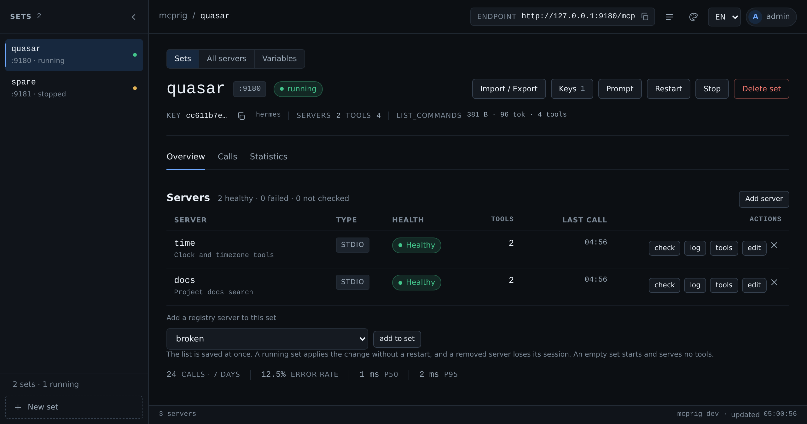

[← Docs index](index.md)
[EN](../en/panel.md) · RU

Файл описывает, что показывает панель, какой API за этим стоит и как проверяется
доступ к обоим.

# Панель

`mcprig panel` отдаёт реестр и одностраничный дашборд из того же бинарника. UI
вшит (`web/`), шага сборки нет, работает со строгим CSP: без inline-скриптов и
стилей.



## Что показывает

| область | содержимое |
| --- | --- |
| топбар | хлебные крошки `mcprig / <страница или набор>`, адрес набора с кнопкой копирования, цветовая схема, язык, пользователь |
| левый рельс | все наборы как имя плюс `:порт · состояние` и точка состояния; **+ Новый набор** |
| страницы | **Наборы**, **Все серверы** и **Переменные** — пилюли в начале содержимого, адреса `#/sets`, `#/servers` и `#/vars`; у **Статистики** остаётся `#/stats/<период>`, у набора — `#/set/<id>`, так что перезагрузка и присланная ссылка попадают туда же, где всё оставили |
| шапка набора | имя, чип порта, бейдж состояния, **Ключи**, **Промт**, **Перезапустить**, **Запустить/Остановить**; под ними префикс ключа с меткой `key:<mark>`, число серверов и инструментов плюс вес `list_commands` (объём, токены) |
| вкладки | **Обзор**, **Вызовы**, **Статистика** — открытого набора, на странице **Наборы** |
| KPI | вызовы, доля ошибок, p50 и p95 выбранного набора за последние 7 дней — строкой-сводкой под таблицей серверов |
| серверы набора | имя со второй строкой (ошибка демона, изоляция, описание), тип, здоровье, число инструментов, последний вызов, **Проверить**, **Лог**, **Инструменты**, **Изменить** и **×**, которая убирает сервер из набора; под таблицей — выбор сервера из реестра и **добавить в набор** |
| страница всех серверов | весь реестр хоста: имя с причиной от демона второй строкой, тип, здоровье, число инструментов из последней **проверки**, наборы, куда сервер входит, и действия **Проверить**, **Авторизовать**, **Лог**, **Изменить** и **×**, которая удаляет сервер из реестра; **Добавить сервер** — в шапке блока |
| таблица вызовов | время, сервер, инструмент, клиент, миллисекунды, статус; поиск и **только ошибки**. Сюда попадают и мета-инструменты (`list_servers`, `list_commands`, `describe_commands`) — с сервером `mcprig`; у провала рядом со статусом видна причина, полный текст — во всплывающей подсказке |
| страница переменных | каждый `${NAME}`, который упоминают серверы, с пометкой, стоит ли значение и откуда оно, форма записи значения и **×**, которая его забывает |
| ящик деталей | хвост лога набора; открывается из шапки, на телефоне занимает всю ширину |
| подвал | `N наборов · M серверов · K запущено` и время последнего обновления |

Здоровье показано как есть: `Здоров`, `Сбой` с причиной от демона второй
строкой и `Без проверки` для сервера, который ещё никто не проверял. Пока
ответ о здоровье не пришёл, в ячейке стоит скелетон, а не догадка. Бейдж
страницы всех серверов — тот же компонент и те же три состояния: сервер вне
открытого набора остаётся **Без проверки**, пока его не проверит **Проверить**
здесь, а сервер остановленного набора так и говорит, что набор выключен. Число
инструментов одного сервера в ответе о здоровье не приходит, поэтому в колонке
**Инструментов** стоит `—`, пока сервер не проверен кнопкой **Проверить**;
итог по всему набору показывает шапка набора.

Всё на странице приходит из API панели ниже плюс `GET /stats` работающих
наборов. В браузере не хранится ничего, кроме выбранной цветовой схемы и языка
интерфейса.

## Редактор серверов

Кнопка **Изменить** в строке страницы **Все серверы** и кнопка
**Добавить сервер** этой страницы открывают
форму поверх панели: имя, описание, транспорт, команда (по аргументу на
строку) или `url` с заголовками, рабочий каталог, `env`, `envAllow`, теги,
переключатель `включён`, две галочки **отдавать клиенту** (`resources`,
`prompts`) и набор полей **песочница** — `mode`, `onUnavailable`,
`network`, `ro` и `rw` (по пути на строку), `memoryMb`, `pids`, `tmpMb`,
`timeoutSec`. Форма пишет через `POST /api/servers` и `PUT /api/servers/<имя>`;
отказ бэкенда показывается в форме своим текстом, а сохранённая запись не
меняется.

Обе галочки **отдавать клиенту** сняты — в записи нет поля `expose`: клиент
MCP видит у этого сервера только инструменты. Поставить их — единственный
способ отдать клиенту его ресурсы или промпты
([meta-tools.md](meta-tools.md#ресурсы-и-промпты)); из формы неизвестное
значение не приходит, а опечатку в `registry.json` бэкенд отбивает текстом
`expose: неизвестный вид …`.

Это единственный способ править блок `sandbox` из интерфейса. Поля и их смысл —
в [configuration.md](configuration.md#песочница); сама панель их не проверяет, а
показывает ответ бэкенда, включая `sandbox: неизвестные поля: …`,
`sandbox допустим только для stdio` и
`тег untrusted требует sandbox: сервер без изоляции не стартует`.

У каждой строки сервера есть кнопка **Лог**: она открывает дровер с логом
набора, отфильтрованным по имени этого сервера — своего файла у сервера нет.
Дровер читает `GET /api/sets/<id>/servers/<name>/logs?lines=200` и печатает
строки как текст; имя, которого в логе нет, даёт «лог пуст», а неудачный
запрос оставляет уже показанные строки и пишет причину над ними.

Кнопка **Инструменты** в строке сервера открывает дровер дескрипторов этого
сервера ([meta-tools.md](meta-tools.md#карантин-дескрипторов)): по строке на
инструмент с состоянием — «одобрен» или «изменился» цветом предупреждения с
кнопкой **Одобрить**. Дровер читает `GET /api/sets/<id>/tools` и оставляет
записи своего сервера; **Одобрить** шлёт
`POST /api/sets/<id>/tools/approve`, список читается заново, и строка тут же
становится «одобрен». До этого прокси отбивает вызовы этого инструмента. Дровер
показывает то, что записал процесс набора: без каталога данных набора
(`MCPRIG_DATA_DIR`) каждый инструмент читается как «одобрен»; записи сервера,
убранного из набора, чистятся при следующей сборке конфига набора.

Страница **Все серверы** показывает и изоляцию — второй строкой записи: `bwrap`,
когда песочница применена; `без изоляции` цветом предупреждения, когда блок
просили, но bubblewrap не стартовал (полная причина от демона — в подсказке); и
`конфиг отвергнут` цветом ошибки у записи с `_configError`. У валидного сервера
без блока `sandbox` маркера нет. Значение берётся из того же поля `isolation`,
которое видят MCP-клиенты в `list_servers`.

Диалог **Ключи** перечисляет id ключей, даты создания и отзыва и заметки. Он
показывает только 8-символьный префикс. Если у набора есть блок `profiles`, в
форме выдачи появляется select **Профиль** (пусто — без профиля): имя уходит в
`POST /api/sets/<id>/keys` как `{"profile":…}`, ответ `400` от демона
показывается в самом диалоге и диалог остаётся открытым, а у каждой строки ключа
стоит бейдж его профиля. У набора без профилей форма прежняя. Подпись существующего ключа правится
на месте: в строке есть поле подписи и кнопка **Сохранить**, которая появляется,
только когда значение отличается от сохранённого; панель шлёт `PATCH` с
`{"note":…}`, перерисовывает список и показывает `restartError` набора
отдельным предупреждением, а не глотает его. Новый выпущенный токен показывается
один раз — как и токен только что созданного закрытого набора: `POST /api/sets`
отдаёт его в теле `201`, а `GET /api/sets` его больше не повторяет. Выдача
ключа прежний активный ключ не отзывает и набор не перезапускает: новый токен
доезжает до работающего набора перезагрузкой, а прежний продолжает работать.
Отзыв последнего действующего ключа останавливает набор; отзыв одного из
нескольких — нет.

## Состав набора

Таблица серверов на вкладке **Обзор** — ещё и место, где набор собирается.
Под таблицей **добавить в набор** предлагает серверы реестра, которых в наборе
ещё нет, а **×** в конце строки убирает этот сервер. Обе кнопки шлют
`PUT /api/sets/<id>` с полным списком `servers` — не диффом, — так что один
запрос несёт одно намерение; после него панель заново читает `GET /api/state`
и перерисовывает шапку, таблицу и выбор. Запрос тихий: отказ показывается
текстом под блоком, а не всплывашкой.

Запущенный набор принимает правку перезагрузкой
([перезагрузка](#перезагрузка-без-перезапуска)): новый сервер подключается
лениво, и его инструменты появляются после первого `list_commands` или
проверки **Проверить**, убранный теряет сессию и кэш. Процесс при этом не
перезапускается — об этом и говорит подсказка под выбором, потому что
перезапуск порвал бы соединения остальных серверов набора. Пустой список
допустим: набор сохраняется, стартует и не отдаёт инструментов; панель
говорит об этом там же и не мешает сохранению.

## Промт для агента

`POST /api/sets/<id>/prompt` собирает один текст из трёх частей: вводной,
перечня инструментов набора и задачи. Тело — `{"task":"…","intro":"…","servers":["…"]}`,
`intro` и `servers` необязательны. Пустая вводная заменяется коротким
шаблоном, пустая задача — это `400` с `задача не задана`, а `servers` сужает
список: имя, которого в наборе нет, тоже даёт `400`. Ответ —
`{"prompt":"…","notes":["…"]}`.

Перечень берётся из живого каталога работающего набора: имена и описания — из
`list_commands`, схемы входа — из `describe_commands`, сжатые в JSON без
отступов. Остановленный набор или набор, который не ответил, отдаёт имена из
`tools.lock.json` — тот же источник, что у `GET /api/sets/<id>/tools`, — и
пишет об этом в `notes`: «набор не запущен, схемы недоступны». Схема одного
инструмента ограничена 4000 символами, весь промт — 64 КиБ; обе обрезки видны
в `notes`. Вводная и задача остаются целыми, режется перечень инструментов.
Текст ошибок проходит ту же маску, что и в `list_servers`: ни токен набора,
ни значение переменной в промт не попадают.

**Промт** в шапке набора открывает диалог: задача обязательна, и до её
заполнения кнопка ничего не делает; вводная необязательна (пустая — значит
шаблон по умолчанию); серверы набора идут чекбоксами — ни одного отмеченного
означает весь набор. **Собрать** шлёт запрос к маршруту выше; текст
возвращается в блок моноширинным шрифтом с кнопками **копировать** и
**скачать .md**, а каждое примечание из `notes` видно над ним с подписью
«примечания:». Остановленный набор открывает тот же диалог и предупреждает
заранее, что в тексте будут только имена инструментов без схем, — чтобы
пропажа схем не оказалась сюрпризом после **Собрать**.

## Все серверы и переменные

Страница **Все серверы** перечисляет весь реестр хоста, а не состав одного
набора. В строке — имя с причиной отказа от демона второй строкой, транспорт,
бейдж здоровья, число инструментов из последней **проверки**, наборы, куда
сервер входит, и действия: **Проверить**
(`POST /api/servers/<name>/probe`), **Авторизовать** у удалённого сервера,
ответившего `401`, **Лог** открытого набора, **Изменить** и **×**, которая
удаляет сервер из реестра — диалог сначала называет наборы, которые он
покидает. Удалить из реестра — не то же самое, что убрать из набора: состав
набора живёт на вкладке **Обзор**.

Страница **Переменные** — место, где `${NAME}` получает значение. Список
показывает каждое имя, которое упоминают серверы, с пометкой `стоит` или
`не стоит` и источником — `openbao`, `file` или `env`, — потому что панель
читает `GET /api/env`, а он несёт имена, пометку и источник и никогда значение.
Форма записывает значение через `PUT /api/env/<NAME>`: имя, значение и
хранилище (`автоматически` — OpenBao, когда он настроен, иначе файл —
`OpenBao` или файл), а **×** забывает значение везде через
`DELETE /api/env/<NAME>` без параметра `store`. Оба ответа приходят сразу, а
наборы, которые используют переменную, перезапускаются в фоне; страница
называет их и добавляет пометку, если имя ещё не упоминает ни один сервер.
Записанное значение обратно не читается: панель не может его показать и
говорит об этом под списком.

## OAuth

У удалённого сервера, который отвечает `401`, в его строке на странице **Все
серверы** есть кнопка **авторизовать** — если сервер входит в открытый набор.
Она запускает поток authorization code внутри демона
и открывает диалог со ссылкой; браузер принадлежит человеку, поэтому панель не
держит его в запросе — состояние читается опросом
`GET /api/sets/<набор>/servers/<сервер>/authorize`.

| что | значение |
| --- | --- |
| адрес возврата | `http://<хост панели>:<порт панели>/oauth/callback` |
| маршрут приёма | публичный: у браузера нет сессии панели, ключ — `state` |
| файл токена | `<каталог данных>/sets/<набор>/oauth.json` |
| после успеха | набор перезапускается сам и подхватывает токен |
| предел ожидания | 10 минут |

Адрес возврата — тот, по которому открыта панель, значит он должен быть
доступен из браузера. Сервер авторизации, который не принимает простой `http`
для не-loopback адреса (динамическая регистрация отвечает
`invalid_redirect_uri`), требует TLS перед панелью; сам поток от этого не
меняется. `mcprig auth --set <набор> <сервер>` делает то же из терминала с
loopback-приёмником — см. [cli.md](cli.md#auth).

## Темы

В панели четыре цветовые схемы — тёмная (по умолчанию), светлая, Nord и
Gruvbox — на одном комплекте CSS-переменных: цвета, радиусы, шаг 4 px и шкала
шрифтов. Меню темы стоит в шапке и переключает атрибут `data-theme` на
`<html>` без перезагрузки; выбор хранится в `localStorage['mcprig.theme']`.
Имена, оставшиеся от прежних версий, работают и переписываются на новые при
первой отрисовке: `mcprig` и `tokyo` означают тёмную, `solarized` — светлую.
Тёмная палитра живёт в `themes.css` на `:root`, поэтому незнакомое имя падает
в неё; CSP при этом не меняется (никаких inline-стилей).

## Язык

Интерфейс говорит по-английски и по-русски. По умолчанию — английский:
переключатель `EN`/`RU` стоит в шапке рядом с выбором схемы, выбор хранится в
`localStorage['mcprig.lang']`, `<html lang>` меняется вместе с ним, а числа и
даты рисует `Intl` в текущей локали (`en-US`/`ru-RU`). Все строки панели лежат
в одном словаре `DICT` в `web/app.js`; разметка `index.html` несёт только
английские значения и ключи `data-i18n`. Строки, которые приходят от демона
(причина ошибки сервера, поле `isolation`, тексты отказа в форме), панель
показывает как есть.

## Маршруты

Статические файлы панели отдаются для `GET`/`HEAD` после аутентификации. API:

| метод и путь | назначение |
| --- | --- |
| `GET /healthz` | публичная проверка живости |
| `GET /` | панель (редирект на `/login`, когда аутентификация включена и сессии нет) |
| `GET /login`, `POST /api/login`, `POST /api/logout` | вход в сессию |
| `GET /api/state` | серверы, наборы, `firstPort` — первая отрисовка. `keyMark` набора — отпечаток `key:<mark>` из статистики для его основного ключа, у открытого набора пусто |
| `GET /api/sets`, `POST /api/sets` | список и создание наборов; новый закрытый набор отдаёт свой токен один раз в теле `201` |
| `PUT /api/sets/<id>`, `DELETE /api/sets/<id>` | изменение и удаление (останавливает набор). Работающий набор правку применяет перезагрузкой, без перезапуска; не применилась — 200 всё равно отдаёт правку плюс `reloadError`. Меняются `port` или `open` — набор перезапускается. `token` в теле заменяет основной ключ, а у набора без действующего ключа создаёт его |
| `POST /api/sets/<id>/start`, `/stop`, `/restart` | жизненный цикл |
| `POST /api/sets/<id>/reload` | применить `servers.json` без перезапуска: `{"reloaded":true,"generation":N,"applied":[…],"restartNeeded":[…],"error":"…"}`. Набор не запущен — `{"reloaded":false,"reason":"набор не запущен"}`, файл всё равно записан. `restartNeeded` непуст или `error` задан — `reloaded:false` и причина в `reason`; ошибка записи — `500` |
| `GET /api/sets/<id>/servers` | здоровье по серверам одного набора |
| `GET /api/sets/<id>/logs?lines=N` | хвост лога (по умолчанию 200 строк) |
| `GET /api/sets/<id>/servers/<name>/logs` | строки лога одного нижестоящего сервера |
| `GET /api/sets/<id>/tools` | `{"tools":[…]}` — записи дескрипторов набора: `server`, `tool`, `hash` (как каталог отдаёт сейчас), `approvedHash` и `state` (`ok`, `changed`) |
| `POST /api/sets/<id>/tools/approve` | одобрить текущий дескриптор: `{"server":"serena","tool":"find_symbol"}` или `{"all":true}` для всего изменившегося; отвечает `{"approved":["serena/find_symbol"]}`, пусто — если одобрять было нечего. Запись пишется с `approvedBy: "panel"` |
| `POST /api/sets/<id>/prompt` | один текст для агента из трёх частей: `{"task":"…","intro":"…","servers":["…"]}` → `{"prompt":"…","notes":["…"]}`. `intro` и `servers` необязательны, пустая задача — `400`; инструменты берутся из живого каталога со схемами входа, остановленный набор отдаёт имена из `tools.lock.json` и пишет об этом в `notes` |
| `POST /api/sets/<id>/keys` | выпустить ключ; ответ содержит единственную копию токена. Прежние ключи остаются действующими — выдача не отзывает старый; набор держит до 8 действующих ключей, девятый получает `409`. Необязательные `{"label":"hermes","profile":"reader"}` дают ключу подпись и сужают его до профиля набора — неизвестное имя даёт `400` с перечнем профилей, набор без `profiles` — `400` с подсказкой добавить блок. Работающий набор получает новый ключ перезагрузкой, без перезапуска; не применилось — в ответе `reloadError` (и его прежнее имя `restartError`) |
| `GET /api/sets/<id>/keys` | `{"keys":[…]}` — `id`, `label`, `profile`, `createdAt`, `revokedAt` каждого ключа, включая отозванные; токена и хэша здесь нет никогда |
| `DELETE /api/sets/<id>/keys/<keyID>` | отозвать один ключ; остальные продолжают работать. Отзыв последнего действующего ключа останавливает набор, в ответе `stopped: true` и `activeKeys: 0` |
| `PATCH /api/sets/<id>/keys/<keyID>` | подписать ключ: `{"label":"hermes"}` (`{"note":…}` тоже принимается); подпись становится меткой клиента в статистике, пустая строка снимает её, работающий набор перезапускается — метки клиентов слушатель читает при старте; перезапуск не удался — в ответе `restartError` |
| `GET /api/servers`, `POST /api/servers` | список и добавление нижестоящих серверов |
| `PUT /api/servers/<name>` | изменение; работающие наборы перезагружаются, а не перезапускаются, и ответ несёт `reloaded` (id наборов, повторено как `restarted` на один релиз) плюс `reloadErrors` (id → причина), если процесс не применил правку |
| `DELETE /api/servers/<name>` | удаление; работающие наборы с этим сервером останавливаются — вместе с ним уходит его сессия. Удаление последнего сервера набора оставляет набор с пустым составом — ключ и порт остаются |
| `POST /api/servers/<name>/probe` | `initialize` + `tools/list`, бюджет 60 с, текст ошибки в теле |
| `GET /api/calls?set=<id>&limit=<N>&before=<time>&after=<time>` | объединённый хвост вызовов работающих наборов и истории остановленных с диска; по умолчанию 50, максимум 500; `before`/`after` — время RFC3339, граница по `time` строки (строго раньше / строго позже, задаётся одно); для одного работающего набора — ещё и `schema` |
| `GET /api/stats?set=<id\|all>&period=today\|7d\|30d\|archive&server=&tool=&client=&bucket=hour\|day\|month` | история вызовов с диска: итоги, ряд, разрезы по инструментам, серверам и клиентам, `bySet` для всех наборов |
| `GET /api/env`, `PUT /api/env/<NAME>`, `DELETE /api/env/<NAME>` | переменные: только имена, флаг заданности и источник — никогда значения; ответ приходит сразу, наборы с этой переменной перезапускаются в фоне (бюджет 60 с), их id — в `restarted`; остановка панели отменяет фоновый перезапуск |
| `POST /api/import` | импорт объекта `mcpServers`; возвращает `added` и `skipped` |
| `GET /api/export/registry`, `GET /api/export?set=<id>` | экспорт реестра или одного набора |
| `POST /api/browse` | открыть живую сессию к серверу для осмотра инструментов |
| `GET /api/browse/<id>`, `DELETE /api/browse/<id>` | прочитать или закрыть эту сессию |
| `POST /api/browse/<id>/{tool,resource,prompt}` | вызвать что-либо в сессии осмотра |

Сессия осмотра подчиняется `permissions` сервера для инструментов так же, как
`invoke_command`; ресурсы и промпты пока не покрыты.

### Перезагрузка без перезапуска

`POST /api/sets/<id>/reload` и правка набора через `PUT /api/sets/<id>` пишут
`servers.json` и шлют `SIGHUP` только процессу набора — не его группе: у
stdio-детей нет обработчика, и они обязаны пережить правку соседа. Процесс
перечитывает файл сам и отвечает файлом `reload.status` рядом с `servers.json` —
`{"nonce":"…","generation":N,"at":"RFC3339","applied":[…],"restartNeeded":[…],"error":"…"}`,
поколение растёт на каждой попытке, а `nonce` повторяет тот, что панель положила
в `reload.request` до сигнала, поэтому запоздалый ответ прошлой попытки не сойдёт
за ответ этой. Панель ждёт ответ до 3 с и возвращает его как есть. Без
перезапуска применяются серверы набора и их поля: добавленный сервер
подключается при первом вызове, удалённый закрывает сессию, неизменённые
сохраняют свои сессии, изменённые `command`, `cwd`, `url`, `env` и `sandbox`
пересоздают только этот сервер, а `permissions`, `enabled` и `description`
обновляются на месте; `rateLimit` и `profiles` берутся из нового файла. Вызов,
уже идущий к пересоздаваемому серверу, падает с «сервер изменён перезагрузкой
конфига — вызов не выполнен, повторите», а не ждёт старый процесс. Транспорт
читается только при старте. Правка `port` или `open` через `PUT /api/sets/<id>`
(и новый активный ключ через key-эндпоинты) перезапускает набор; ручная правка
`servers.json` с `path`, `host` или `allowedHosts` возвращается в
`restartNeeded`, и набор тогда перезапускают вручную
(`POST /api/sets/<id>/restart`). `POST /api/sets/<id>/reload` сам ничего не
перезапускает: непустой `restartNeeded` отвечает `reloaded:false` с этой
причиной. `env` и `envAllow` сервера тоже не перезагружаются — окружение
набора фиксируется при его старте, — поэтому `PUT /api/servers/<имя>`, который
их меняет, перезапускает наборы с этим сервером и всё равно перечисляет их в
`reloaded`.

Битый конфиг процесс не применяет: он живёт на прежнем, а причина приходит в
`error` и в `reload.status`.

Имена наборов и серверов должны соответствовать `^[a-z0-9][a-z0-9_-]{0,63}$`.
Набор может быть совсем без серверов: его создают и запускают до первого
сервера, и тогда отвечают только мета-тулы — `list_servers` отдаёт пустой
список. Ключ и порт живут отдельно от состава, поэтому ради удаления
последнего сервера набор удалять не нужно. При правке набора `servers: []`
очищает состав, а отсутствие ключа `servers` его не трогает. Хвост лога набора —
`<data-dir>/sets/<id>/mcprig.log`, ротируется в `.log.1` при
5 МиБ. Файл `lazy-mcp.log`, унаследованный от прежнего прокси, переименовывается
при первом старте набора: старый хвост остаётся виден в панели. При сбое ротации
вывод не теряется: старый файл остаётся, а текст ошибки виден в поле `error`
статуса набора. Если `port` не задан, менеджер выделяет свободный из 9100–9199,
а заданный обязан быть свободен в системе, иначе `409` «порт N занят другим
процессом». `id` и `token` в теле создания игнорируются.

`/api/calls` опрашивает `/stats` каждого работающего набора с таймаутом 2 с и
его ключом из реестра. **Работающий** набор, который не отвечает, попадает в
`unreachable` по id; его текст ошибки не передаётся. Остановленный набор не
опрашивается: хвост и счётчики берутся из сырого журнала на диске (см.
[История вызовов](#история-вызовов)), поэтому если каталога нет, ответ пустой,
а не `unreachable`.

Отказы лимита частоты набора в `calls` и `counters` не попадают — до
нижестоящего сервера такой вызов не дошёл. Они едут отдельно: `throttled`
(сумма по наборам ответа) и `throttledTools` (`server/tool` → счётчик). Оба
поля отсутствуют, пока отказов не было.

Страницы идут по времени строки: `before=<время>` отдаёт вызовы строго раньше
него, `after=<время>` — строго позже. Оба сразу отвечают `400`, как и значение
не в RFC3339 (наносекунды допустимы). Время последней строки страницы
отправляется как `before` для следующей:

```
GET /api/calls?set=opencode&limit=100&before=2026-11-08T12:00:03.512Z
```

Глубина ограничена хвостом набора: `/stats` работающего набора держит последние
512 вызовов, а остановленный отдаёт 512 самых новых строк журнала, поэтому
`before` за их пределы отдаёт пустой список, а не старые строки —
глубже история есть только в `/api/stats`. Два вызова с одинаковым временем
на границе страницы — известное ограничение: следующая страница пропустит
второй; страницы никогда не повторяют строку.

Таблица вызовов загружает 100 строк и показывает под собой **Показать ещё**.
Кнопка отправляет `time` последней строки как `before`, дописывает следующую
страницу и прячется, когда страница пришла неполной; после первого нажатия
панель останавливает своё обновление раз в 5 с, чтобы догруженные страницы не
затирались, и показывает рядом **возобновить** — оно перезагружает первую
страницу и возвращает обновление.

Ответ с `?set=<id>` несёт поле `schema` — сколько контекста стоит перечень
инструментов этого набора: `schemaBytes` (длина JSON, который отдаёт
`list_commands` по всему набору), `schemaTokens` (та же длина, делённая на 4 с
округлением вверх) и `tools` (число инструментов). Числа берутся из снимка
`/stats` набора, то есть из его кэша инструментов, без обращений к нижестоящим
серверам. В объединённом ответе без `set` поля нет: вес у каждого набора свой.
Пока набор ни разу не заполнил кэш, поля тоже нет; у остановленного набора его
нет всегда — живого снимка читать неоткуда. Панель показывает его в шапке
карточки строкой `list_commands`: `20 КБ · 5 067 ток · 22 инстр.`

## История вызовов

У работающего набора хвост и счётчики `/api/calls` живут в памяти его процесса.
Остановленный отвечает из сырого журнала ниже: и хвост, и счётчики покрывают
сегодня и шесть предыдущих суток — то же окно, что `period=7d` у `/api/stats`, —
с точными процентилями; открытый набор без токена показывает в колонке клиента
`(аноним)` и не отдаёт текст ошибки — так же, как его живой `/stats`. Строки
старше окна остаются только в `/api/stats`.

История ниже лежит на диске у самого набора, рядом с его конфигом: для набора
это `<data-dir>/sets/<id>/stats/`, для standalone `serve` — каталог того
`servers.json`, с которым он запущен. Файлы — `0600`, каталог — `0700`.

| файл | содержимое | хранится |
| --- | --- | --- |
| `raw-YYYY-MM-DD.jsonl` | строка на вызов: `{time, client, server, tool, ms, failed, err}`; `err` — причина провала, одна строка не длиннее 300 байт, у успешного вызова поля нет | сегодня + 7 суток |
| `day-YYYY-MM-DD.json` | для каждой тройки `(client, server, tool)`: `{client, server, tool, calls, failures, totalMs, hist, lastMs}` | до 30 суток |
| `month-YYYY-MM.json` | те же тройки по дням в `days` — повторная свёртка дня перезаписывает его, а не удваивает | всегда |

`hist` — фиксированная гистограмма в миллисекундах: `1, 2, 5, 10, 20, 50, 100,
200, 500, 1000, 2000, 5000, 10000, ∞`.

Ротация и уборка идут при старте набора и дальше раз в сутки: закончившиеся
сутки получают day-файл из сырого журнала, дни старше 30 уходят в месячный
файл, журналы старше 7 суток удаляются. Запись не блокирует вызов инструмента:
строка идёт в ограниченный канал, который обслуживает одна горутина, а полный
канал теряет строку — это видно как `stats.dropped` в `/stats` набора.

`GET /api/stats` отвечает за один период:

```text
period=today    с 00:00 сегодня        процентили точные по raw, approximate=false
period=7d       последние 7 суток       точные, approximate=false
period=30d      последние 30 суток      по гистограмме, approximate=true
period=archive  старше 30 суток         по месячным файлам, approximate=true
```

`bucket=hour|day|month` задаёт шаг ряда (по умолчанию — по периоду): today и 7d
отвечают по часам (или по суткам с `bucket=day`), 30d — по суткам, архив — по
месяцам. Неизвестный `bucket` — `400`. `server`, `tool` и `client` фильтруют все части ответа. `set=all` (или
без `set`) складывает все наборы. Разобранные файлы истории кэшируются: файл
перечитывается только при смене `mtime` или размера, поэтому повторный запрос
того же периода не читает диск заново. Ответ: `period`, `from`, `to`, `approximate`,
`totals` и `series` (`{t, calls, failures, p50ms, p95ms}`), плюс разрезы
`tools`, `servers`, `clients` той же формы. `set=all` (или пустой `set`)
добавляет `bySet`: `{set, calls, failures, totalMs}` по каждому набору, у
которого в периоде есть вызовы, — по этому полю считается таблица наборов;
набор без вызовов в периоде не попадает в разрез, а не отвечает нулями. У
одного набора `bySet` нет. Фильтр набора во вкладке **Статистика** следует за
рельсом: открытая статистика показывает выбранный набор, переключение набора
переключает и её; ручной выбор в списке живёт до следующего переключения в
рельсе. Набор без каталога истории
попадает в `unreachable` по id, остальной ответ пустой; неизвестный id
набора — `404`.

## Здоровье

| точка | ответ |
| --- | --- |
| `GET /healthz` (панель) | `{"status":"ok","sets":N}` или `503` со `status: "degraded"`, когда набор с `autostart` не работает |
| `GET /healthz` (набор) | просто `ok` |
| `GET /stats` (набор) | JSON-снимок для панели; нужен `Authorization`, если набор не открыт |

Собственный взгляд панели на здоровье (`GET /api/sets/<id>/servers`) идёт с
бюджетом загрузки 30 с — вдвое больше 15-секундной пробы набора, — поэтому
прогревающийся набор не выглядит как `context deadline exceeded` у всех
серверов сразу; ответ кэшируется на 15 с с single-flight, так что
открытие дашборда не множит пробы по вкладкам браузера.

Обе проверки живости — панели и набора — публичны, чтобы проверка контейнера или
systemd могла использовать их без учётных данных. В `/healthz` панели нет имён
наборов.

Старт и остановка набора и переход сервера в нездоровье пишутся одной строкой в
stdout панели (`набор <id>: запущен|остановлен`, `набор <id>: сервер <имя>
unhealthy`) — его забирает systemd. Отказ сервера попадает в журнал только при
смене состояния, а не на каждом цикле опроса health. Тот же опрос панель ведёт
в фоне раз в 30 с по всем запущенным наборам, поэтому строки появляются и без
открытой панели.

## Доступ

Режимы задаются `MCPRIG_PASSWORD`, `MCPRIG_PROXY_SECRET` и `MCPRIG_AUTH=off`;
см. [cli.md](cli.md#panel). Панель сама слушает https, когда заданы
`MCPRIG_TLS_CERT` и `MCPRIG_TLS_KEY`; иначе ставьте её за обратный прокси или
держите на loopback.

```text
none      MCPRIG_AUTH=off
password  MCPRIG_PASSWORD или MCPRIG_PASSWORD_HASH
proxy     MCPRIG_PROXY_SECRET + MCPRIG_USER_HEADER
both      пароль и прокси-секрет
```

При парольной аутентификации панель ставит `mcp_session` (HMAC-SHA256, 12 ч,
`HttpOnly`, `SameSite=Lax`, `Secure` поверх TLS) и держит сессии в памяти.
Cookie получает `Secure` всегда, когда `MCPRIG_PUBLIC_URL` — `https` или у панели
свой сертификат, а не только когда запрос пришёл по TLS: TLS-прокси отдаёт
процессу открытый http, и cookie уходить открытой не должна. Вход
ограничен 5 неудачами в минуту на IP; одновременно выполняется не более двух
хешей scrypt (остальные ждут; сверх 8 ожидающих вход отвечает `429`).
`POST /api/login` отвечает `400`, когда `user` или `password` пусты (`401`
означает неверный пароль). Неаутентифицированный `GET /` редиректит на
`/login`; вызовы API получают
`401 {"error":"нужна авторизация","login":true}`.

Прокси-аутентификация принимает запрос, когда заголовок пользователя
(`Remote-User` по умолчанию) непуст и `x-mcp-proxy-secret` совпадает с
`MCPRIG_PROXY_SECRET` за постоянное время. Оба режима можно совмещать; любого
одного достаточно для прохода.

Записи (`POST`/`PUT`/`DELETE`) отклоняются, когда `Sec-Fetch-Site` равен
`cross-site`, когда `Origin` не совпадает с `Host` или когда тело не JSON.
При аутентификации по сессионной cookie `Origin` обязателен: без него запись
получает `403` «не хватает заголовка Origin» — браузер шлёт его на каждый такой
запрос, а подделка с чужого сайта — нет. API по заголовкам прокси и вход
(`POST /api/login`, cookie ещё нет) проверки не касаются.

`Origin` сравнивается целиком — схема, хост и порт; `MCPRIG_ALLOWED_HOSTS` — не
список источников: это имена самой панели. `X-Forwarded-Proto` и
`X-Forwarded-Host` доверяются только при заданном `MCPRIG_PROXY_SECRET`:
тогда доверенный прокси делает `https`-запрос защищённым, а переданный хост —
публичным именем панели, и `https`-Origin совпадает. Без секрета оба заголовка
игнорируются — иначе любой клиент объявил бы свой запрос `https` и обошёл
проверку. Доверие включается *заданием* `MCPRIG_PROXY_SECRET`, а не проверкой
соединившегося: порт панели не должен быть доступен в обход прокси. У
`http`-панели с секретом браузерные записи отбиваются — запрос считается
`https`, — поэтому задайте `MCPRIG_PUBLIC_URL=https://…` под то, что видит
браузер.

Redirect OAuth берётся из `MCPRIG_PUBLIC_URL`, когда он задан
(`<publicUrl>/oauth/callback`, префикс пути сохраняется); без него панель
собирает его из `MCPRIG_HOST` и `MCPRIG_PORT`, и переданные заголовки в этом не
участвуют. Регистрируйте redirect у провайдера в том виде, в каком панель его
печатает, — `mcprig doctor` показывает действующее значение.

`Host` должен быть в `MCPRIG_ALLOWED_HOSTS`; пустой список означает только
loopback.

## См. также

- [cli.md#panel](cli.md#panel) — как запустить панель и задать режим доступа.
- [configuration.md](configuration.md) — серверы и наборы, которые правит панель.
- [meta-tools.md](meta-tools.md) — счётчики и источник истории вызовов.
- [troubleshooting.md](troubleshooting.md) — 401 и 403 от панели.
