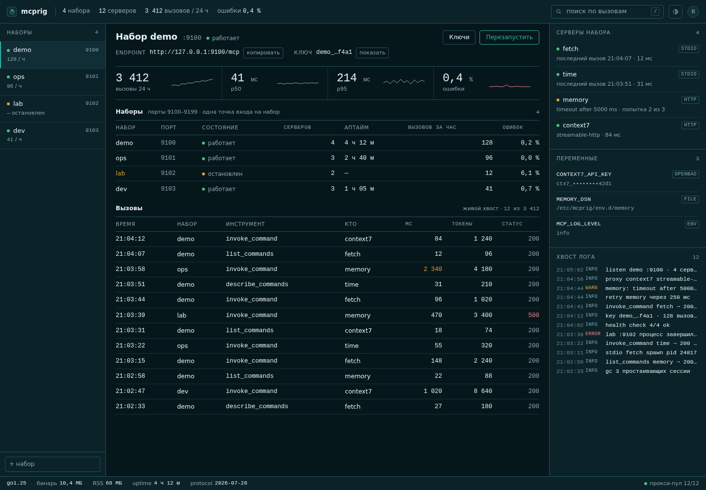

Файл описывает, что показывает панель, какой API за этим стоит и как проверяется
доступ к обоим.

# Панель

`mcprig panel` отдаёт реестр и одностраничный дашборд из того же бинарника. UI
вшит (`web/`), шага сборки нет, работает со строгим CSP: без inline-скриптов и
стилей.



## Что показывает

| область | содержимое |
| --- | --- |
| топбар | хлебные крошки `mcprig / <набор>`, точка входа с кнопкой копирования, цветовая схема, язык, пользователь |
| левый рельс | все наборы как имя плюс `:порт · состояние` и точка состояния; **+ Новый набор** |
| шапка набора | имя, чип порта, бейдж состояния, **Ключи**, **Перезапустить**, **Запустить/Остановить**, префикс ключа и сразу под ним — число серверов и инструментов плюс вес `list_commands` (объём, токены) |
| вкладки | **Обзор**, **Вызовы**, **Статистика** |
| KPI | вызовы, доля ошибок, p50 и p95 выбранного набора за последние 7 дней |
| серверы набора | имя со второй строкой (ошибка демона, изоляция, описание), тип, здоровье, число инструментов, последний вызов, **Проверить** и **Изменить** |
| таблица вызовов | время, сервер, инструмент, клиент, миллисекунды, статус; поиск и **только ошибки** |
| ящик деталей | реестр серверов хоста, переменные и лог набора; открывается из шапки, на телефоне занимает всю ширину |
| подвал | `N наборов · M серверов · K запущено` и время последнего обновления |

Здоровье показано как есть: `Здоров`, `Сбой` с причиной от демона второй
строкой и `Без проверки` для сервера, который набор ещё не проверял. Пока
ответ о здоровье не пришёл, в ячейке стоит скелетон, а не догадка. Число
инструментов одного сервера в ответе о здоровье не приходит, поэтому в колонке
**Инструментов** стоит `—`, пока сервер не проверен кнопкой **Проверить**;
итог по всему набору показывает шапка набора.

Всё на странице приходит из API панели ниже плюс `GET /stats` работающих
наборов. В браузере не хранится ничего, кроме выбранной цветовой схемы и языка
интерфейса.

## Редактор серверов

Вкладка **серверы** в ящике деталей и кнопка **Добавить сервер** открывают
форму поверх панели: имя, описание, транспорт, команда (по аргументу на
строку) или `url` с заголовками, рабочий каталог, `env`, `envAllow`, теги,
переключатель `включён` и набор полей **песочница** — `mode`, `onUnavailable`,
`network`, `ro` и `rw` (по пути на строку), `memoryMb`, `pids`, `tmpMb`,
`timeoutSec`. Форма пишет через `POST /api/servers` и `PUT /api/servers/<имя>`;
отказ бэкенда показывается в форме своим текстом, а сохранённая запись не
меняется.

Это единственный способ править блок `sandbox` из интерфейса. Поля и их смысл —
в [configuration.md](configuration.md#песочница); сама панель их не проверяет, а
показывает ответ бэкенда, включая `sandbox: неизвестные поля: …`,
`sandbox допустим только для stdio` и
`тег untrusted требует sandbox: сервер без изоляции не стартует`.

Список реестра в ящике показывает и изоляцию — второй строкой записи: `bwrap`,
когда песочница применена; `без изоляции` цветом предупреждения, когда блок
просили, но bubblewrap не стартовал (полная причина от демона — в подсказке); и
`конфиг отвергнут` цветом ошибки у записи с `_configError`. У валидного сервера
без блока `sandbox` маркера нет. Значение берётся из того же поля `isolation`,
которое видят MCP-клиенты в `list_servers`.

Диалог **Keys** перечисляет id ключей, даты создания и отзыва и заметки. Он
показывает только 8-символьный префикс. Подпись существующего ключа правится
на месте: в строке есть поле подписи и кнопка **Сохранить**, которая появляется,
только когда значение отличается от сохранённого; панель шлёт `PATCH` с
`{"note":…}`, перерисовывает список и показывает `restartError` набора
отдельным предупреждением, а не глотает его. Новый выпущенный токен показывается
один раз — как и токен только что созданного закрытого набора: `POST /api/sets`
отдаёт его в теле `201`, а `GET /api/sets` его больше не повторяет. Выпуск
ключа позже отзывает предыдущий активный ключ и перезапускает набор, если он
работает; отзыв активного ключа останавливает набор.

## Темы

В панели четыре цветовые схемы — тёмная (по умолчанию), светлая, Nord и
Gruvbox — на одном наборе CSS-переменных: цвета, радиусы, шаг 4 px и шкала
шрифтов. Меню темы стоит в шапке и переключает атрибут `data-theme` на
`<html>` без перезагрузки; выбор хранится в `localStorage['mcprig.theme']`.
Имена, оставшиеся от прежних версий, работают и переписываются на новые при
первой отрисовке: `mcprig` и `tokyo` означают тёмную, `solarized` — светлую.
Тёмная палитра живёт в `themes.css` на `:root`, поэтому незнакомое имя падает
в неё; CSP при этом не меняется (никаких inline-стилей).

## Язык

Интерфейс говорит по-английски и по-русски. По умолчанию — английский:
переключатель `EN`/`RU` стоит в шапке рядом с выбором схемы, выбор хранится в
`localStorage['mcprig.lang']`, `<html lang>` меняется вместе с ним, а числа и
даты рисует `Intl` в текущей локали (`en-US`/`ru-RU`). Все строки панели лежат
в одном словаре `DICT` в `web/app.js`; разметка `index.html` несёт только
английские значения и ключи `data-i18n`. Строки, которые приходят от демона
(причина ошибки сервера, поле `isolation`, тексты отказа в форме), панель
показывает как есть.

## Маршруты

Статические файлы панели отдаются для `GET`/`HEAD` после аутентификации. API:

| метод и путь | назначение |
| --- | --- |
| `GET /healthz` | публичная проверка живости |
| `GET /` | панель (редирект на `/login`, когда аутентификация включена и сессии нет) |
| `GET /login`, `POST /api/login`, `POST /api/logout` | вход в сессию |
| `GET /api/state` | серверы, наборы, `firstPort` — первая отрисовка |
| `GET /api/sets`, `POST /api/sets` | список и создание наборов; новый закрытый набор отдаёт свой токен один раз в теле `201` |
| `PUT /api/sets/<id>`, `DELETE /api/sets/<id>` | изменение (перезапускает работающий набор) и удаление (останавливает его) |
| `POST /api/sets/<id>/start`, `/stop`, `/restart` | жизненный цикл |
| `GET /api/sets/<id>/servers` | здоровье по серверам одного набора |
| `GET /api/sets/<id>/logs?lines=N` | хвост лога (по умолчанию 200 строк) |
| `GET /api/sets/<id>/servers/<name>/logs` | строки лога одного нижестоящего сервера |
| `POST /api/sets/<id>/keys` | выпустить ключ; ответ содержит единственную копию токена |
| `DELETE /api/sets/<id>/keys/<keyID>` | отозвать ключ; отзыв активного останавливает набор, в ответе `stopped: true` |
| `PATCH /api/sets/<id>/keys/<keyID>` | подписать ключ: `{"note":"hermes"}`; подпись становится меткой клиента в статистике, пустая строка снимает её, работающий набор перезапускается |
| `GET /api/servers`, `POST /api/servers` | список и добавление нижестоящих серверов |
| `PUT /api/servers/<name>`, `DELETE /api/servers/<name>` | изменение и удаление; работающие наборы перезапускаются |
| `POST /api/servers/<name>/probe` | `initialize` + `tools/list`, бюджет 60 с, текст ошибки в теле |
| `GET /api/calls?set=<id>&limit=<N>` | объединённый хвост вызовов работающих наборов; по умолчанию 50, максимум 500; для одного набора — ещё и `schema` |
| `GET /api/stats?set=<id\|all>&period=today\|7d\|30d\|archive&server=&tool=&client=&bucket=hour\|day\|month` | история вызовов с диска: итоги, ряд, разрезы по инструментам, серверам и клиентам, `bySet` для всех наборов |
| `GET /api/env`, `PUT /api/env/<NAME>`, `DELETE /api/env/<NAME>` | переменные: только имена, флаг заданности и источник — никогда значения; ответ приходит сразу, наборы с этой переменной перезапускаются в фоне (бюджет 60 с), их id — в `restarted`; остановка панели отменяет фоновый перезапуск |
| `POST /api/import` | импорт объекта `mcpServers`; возвращает `added` и `skipped` |
| `GET /api/export/registry`, `GET /api/export?set=<id>` | экспорт реестра или одного набора |
| `POST /api/browse` | открыть живую сессию к серверу для осмотра инструментов |
| `GET /api/browse/<id>`, `DELETE /api/browse/<id>` | прочитать или закрыть эту сессию |
| `POST /api/browse/<id>/{tool,resource,prompt}` | вызвать что-либо в сессии осмотра |

Имена наборов и серверов должны соответствовать `^[a-z0-9][a-z0-9_-]{0,63}$`.
Хвост лога набора — `<data-dir>/sets/<id>/mcprig.log`, ротируется в `.log.1` при
5 МиБ. Файл `lazy-mcp.log`, унаследованный от прежнего прокси, переименовывается
при первом старте набора: старый хвост остаётся виден в панели. Сбой ротации
(переименовать или открыть новый файл не вышло) не теряет вывод: старый файл
остаётся, а текст ошибки виден в поле `error` статуса набора.
Набору нужен хотя бы один существующий сервер; его `port`, если задан, должен
быть 9100–9199 и свободен в системе, иначе менеджер выделяет порт сам, а
занятый процессом порт даёт `409` «порт N занят другим процессом». `id` и `token` в
теле создания игнорируются.

`/api/calls` опрашивает `/stats` каждого работающего набора с таймаутом 2 с и
его ключом из реестра. Набор, который не отвечает, попадает в `unreachable` по
id; его текст ошибки не передаётся.

Ответ с `?set=<id>` несёт поле `schema` — сколько контекста стоит перечень
инструментов этого набора: `schemaBytes` (длина JSON, который отдаёт
`list_commands` по всему набору), `schemaTokens` (та же длина, делённая на 4 с
округлением вверх) и `tools` (число инструментов). Числа берутся из снимка
`/stats` набора, то есть из его кэша инструментов, без обращений к нижестоящим
серверам. В объединённом ответе без `set` поля нет: вес у каждого набора свой.
Пока набор ни разу не заполнил кэш, поля тоже нет. Панель показывает их в шапке
карточки строкой `list_commands`: `20 КБ · 5 067 ток · 22 инстр.`

## История вызовов

Счётчики `/api/calls` живут в памяти набора и умирают вместе с процессом. История
ниже лежит на диске у самого набора, рядом с его конфигом: для набора это
`<data-dir>/sets/<id>/stats/`, для standalone `serve` — каталог того
`servers.json`, с которым он запущен. Файлы — `0600`, каталог — `0700`.

| файл | содержимое | хранится |
| --- | --- | --- |
| `raw-YYYY-MM-DD.jsonl` | строка на вызов: `{time, client, server, tool, ms, failed}`; текста ошибки нет | сегодня + 7 суток |
| `day-YYYY-MM-DD.json` | для каждой тройки `(client, server, tool)`: `{client, server, tool, calls, failures, totalMs, hist, lastMs}` | до 30 суток |
| `month-YYYY-MM.json` | те же тройки по дням в `days` — повторная свёртка дня перезаписывает его, а не удваивает | всегда |

`hist` — фиксированная гистограмма в миллисекундах: `1, 2, 5, 10, 20, 50, 100,
200, 500, 1000, 2000, 5000, 10000, ∞`.

Ротация и уборка идут при старте набора и дальше раз в сутки: закончившиеся
сутки получают day-файл из сырого журнала, дни старше 30 уходят в месячный
файл, журналы старше 7 суток удаляются. Запись не блокирует вызов инструмента:
строка идёт в ограниченный канал, который обслуживает одна горутина, а полный
канал теряет строку — это видно как `stats.dropped` в `/stats` набора.

`GET /api/stats` отвечает за один период:

```text
period=today    с 00:00 сегодня        процентили точные по raw, approximate=false
period=7d       последние 7 суток       точные, approximate=false
period=30d      последние 30 суток      по гистограмме, approximate=true
period=archive  старше 30 суток         по месячным файлам, approximate=true
```

`bucket=hour|day|month` задаёт шаг ряда (по умолчанию — по периоду): today и 7d
отвечают по часам (или по суткам с `bucket=day`), 30d — по суткам, архив — по
месяцам. Неизвестный `bucket` — `400`. `server`, `tool` и `client` фильтруют все части ответа. `set=all` (или
без `set`) складывает все наборы. Разобранные файлы истории кэшируются: файл
перечитывается только при смене `mtime` или размера, поэтому повторный запрос
того же периода не читает диск заново. Ответ: `period`, `from`, `to`, `approximate`,
`totals` и `series` (`{t, calls, failures, p50ms, p95ms}`), плюс разрезы
`tools`, `servers`, `clients` той же формы. `set=all` (или пустой `set`)
добавляет `bySet`: `{set, calls, failures, totalMs}` по каждому набору, у
которого в периоде есть вызовы, — по этому полю считается таблица наборов;
набор без вызовов в периоде не попадает в разрез, а не отвечает нулями. У
одного набора `bySet` нет. Фильтр набора во вкладке **Статистика** следует за
рельсом: открытая статистика показывает выбранный набор, переключение набора
переключает и её; ручной выбор в списке живёт до следующего переключения в
рельсе. Набор без каталога истории
попадает в `unreachable` по id, остальной ответ пустой; неизвестный id
набора — `404`.

## Здоровье

| точка | ответ |
| --- | --- |
| `GET /healthz` (панель) | `{"status":"ok","sets":N}` или `503` со `status: "degraded"`, когда набор с `autostart` не работает |
| `GET /healthz` (набор) | просто `ok` |
| `GET /stats` (набор) | JSON-снимок для панели; нужен `Authorization`, если набор не открыт |

Собственный взгляд панели на здоровье (`GET /api/sets/<id>/servers`) идёт с
бюджетом загрузки 30 с — вдвое больше 15-секундной пробы набора, — поэтому
набор, который ещё прогревается, не показывается как `context deadline exceeded`
сразу у всех серверов; ответ кэшируется на 15 с с single-flight, так что
открытие дашборда не множит пробы по вкладкам браузера.

Обе проверки живости — панели и набора — публичны, чтобы проверка контейнера или
systemd могла использовать их без учётных данных. В `/healthz` панели нет имён
наборов.

Старт и остановка набора и переход сервера в нездоровье пишутся одной строкой в
stdout панели (`набор <id>: запущен|остановлен`, `набор <id>: сервер <имя>
unhealthy`) — его забирает systemd. Отказ сервера попадает в журнал только при
смене состояния, а не на каждом цикле опроса health. Тот же опрос панель ведёт
в фоне раз в 30 с по всем запущенным наборам, поэтому строки появляются и без
открытой панели.

## Доступ

Режимы задаются `MCPRIG_PASSWORD`, `MCPRIG_PROXY_SECRET` и `MCPRIG_AUTH=off`;
см. [cli.md](cli.md#panel). Встроенного TLS нет: ставьте панель за обратный
прокси или держите её на loopback.

```text
none      MCPRIG_AUTH=off
password  MCPRIG_PASSWORD или MCPRIG_PASSWORD_HASH
proxy     MCPRIG_PROXY_SECRET + MCPRIG_USER_HEADER
both      пароль и прокси-секрет
```

При парольной аутентификации панель ставит `mcp_session` (HMAC-SHA256, 12 ч,
`HttpOnly`, `SameSite=Lax`, `Secure` поверх TLS) и держит сессии в памяти. Вход
ограничен 5 неудачами в минуту на IP и выполняет не более одного scrypt за раз.
`POST /api/login` отвечает `400`, когда `user` или `password` пусты (`401`
означает неверный пароль). Неаутентифицированный `GET /` редиректит на
`/login`; вызовы API получают
`401 {"error":"нужна авторизация","login":true}`.

Прокси-аутентификация принимает запрос, когда заголовок пользователя
(`Remote-User` по умолчанию) непуст и `x-mcp-proxy-secret` совпадает с
`MCPRIG_PROXY_SECRET` за постоянное время. Оба режима можно совмещать; любого
одного достаточно для прохода.

Записи (`POST`/`PUT`/`DELETE`) отклоняются, когда `Sec-Fetch-Site` равен
`cross-site`, когда `Origin` не совпадает с `Host` или когда тело не JSON.
При аутентификации по сессионной cookie `Origin` обязателен: без него запись
получает `403` «нужен заголовок Origin» — браузер шлёт его на каждый такой
запрос, а подделка с чужого сайта — нет. API по заголовкам прокси и вход
(`POST /api/login`, cookie ещё нет) проверки не касаются.

`Origin` сравнивается целиком — схема, хост и порт; `MCPRIG_ALLOWED_HOSTS`
источником не является (это имена самой панели). За TLS-прокси передавайте
`X-Forwarded-Proto: https` или `X-Forwarded-Host` (при другом публичном порте —
ещё `X-Forwarded-Port`): без них запрос выглядит http-шным, и панель отклонит
`https`-Origin на записи. Тот же эффект даёт настроенный `MCPRIG_PROXY_SECRET`
(доверенный прокси); `http`-Origin при этом по-прежнему отклоняется.

`Host` должен быть в `MCPRIG_ALLOWED_HOSTS`; пустой список означает только
loopback.
